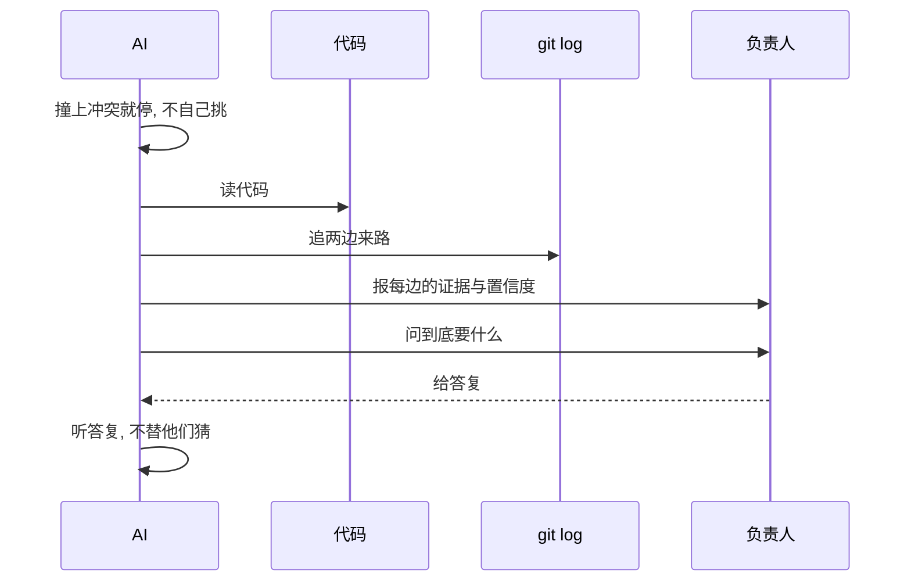
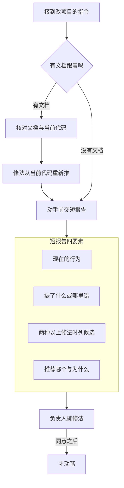

# 02-工作原则

> **状态**: **living**. 这套规则文件的入口在根 [AGENTS.md](../../AGENTS.md), 编号和阅读时机见那份索引.  
> 会话身份与聊天口吻在根 `AGENTS.md` 里, 每次回复都适用, 不在这一份里.

## 工作原则

- **记忆**: 定下来的决定, 约定, 坑, 文档更正, 都记进这套规则文件,  
  下一个会话直接从这些出发, 不用重新摸一遍. 没整理的个人材料放 [docs/dev/JOTTINGS.md](../dev/JOTTINGS.md).  
  各 agent 自己的私有记忆文件只收绑到那个 agent 的事 (它自己的工具, 习惯, 会话进度);  
  管全体 agent 的规矩一律先进这套规则文件, 私有记忆里最多留一份执行提醒.  
  不确定该记什么, 或者记到哪, 跟用户商量.
- **不许猜**: 先查代码库和文档. 每次改动都要拿得出证据: 哪个文件, 哪一行, 哪个小节.  
  "这条规则哪儿都没有" 是同一类断言, 也要同一类证据, 所以先全仓库 grep, 别只看读过的文件.  
  自己写的校验脚本也一样: 扫描范围按全仓来, 不按自己点名的文件清单来.  
  文档里已经有现成答案时 (一份问题清单, 一份早先的报告), 先自己查, 查完再读那份答案,  
  免得被它先入为主.  
  一件事定不下来, 或者几种做法都走得通, 就把发现摆出来问用户. 写 `unknown`, 别编一个值.  
  撞上冲突就该停, 不等于可以自己挑一个: 先查再说.  
  先读代码, 再在 `git log` 里把两边各自的来路追一遍. 每一边追到了什么证据, 你自己有多信, 都报出来,  
  然后问负责人到底要什么. 听他们的答复, 别默默替他们猜.  
  一条指令只管被点名的东西: 第二句看着像同一个问题, 就放进要问的清单, 别并进同一次修改.

撞上冲突之后, 从停手查证到问负责人的一来一回, 画成下面这张时序图:

- **先报告后动手**: 你接到一条要改项目的指令, 要先交一份报告等负责人回话, 然后才动手改.  
  有文档跟着目标走时, 先回去核对它说的和当前代码还对不对, 因为文档可能过时, 也可能本来就错 (见 [01-判据](01-判据.md)).  
  文档里已经写好的修法不是照着执行的答案: 要像核对问题本身那样, 从当前代码重新推.  
  然后在动手之前给负责人一份短报告, 写清这些: 现在是什么行为, 缺了什么或者哪里错了,  
  有两种以上修法时把候选列出来, 还有你推荐哪一个和为什么.  
  负责人挑修法. 他同意之后才动笔.  
  spec 子任务第 0 步那份报告就是这份报告; 负责人新下的指令带来的其他改动, 同样得先给这份短报告.  
  review 发现的处理不是新指令, 按下面 `开发与确认的分工` 走, 不重复交报告.  
  这是把 spec 流程的确认纪律用到每一次改动上, 有没有文档都算, 每个会话都约束.

这条流程的走向, 画成下面这张图:

- **一口气做完**: 一个内聚的改动单元 (一个 spec 子任务, 一次独立改动, 一次文档修订,  
  单元是什么都一样) 要在连着的一段时间里做到可以验证为止.  
  同一个单元不许留下没做完的东西: 不许推给以后的会话或以后的改动,  
  也不许因为中间冒出确认点, 就把没做完的状态当成做完.  
  当 AI 停在确认点等负责人同意时, AI 应认定这个单元不算留下没做完的东西; 确认点要的是一个决定,  
  不会把整个单元结束掉.  
  当改的时候发现了一个问题时, AI 应在改动扩到这个问题之前先把它写进报告, 哪怕这个问题看着就属于本单元;  
  报出来也不算留了没做完的部分.  
  当负责人答复之后, AI 应把这个问题算作本单元的一部分.  
  当 AI 挑候选时, AI 应只从跟这个问题有关的东西里挑 (边界怎么划: 见 "一条指令只管被点名的东西").  
  当 AI 把候选列出来时, AI 应在候选里推荐那个能把问题彻底解决的; 便宜的那个只当候选列出来, 绝不当作默认;  
  文档里有评级或某一列时, AI 也不能拿它当理由挑浅的那个 (见 [01-判据](01-判据.md)).
- **开发与确认的分工**: 中间阶段的 review 和发现处理属于开发阶段, AI 自己循环, 负责人不参与判定;  
  负责人显式参与的是提交前的最终 review, 加上技术大方向和原始需求的把控; 13 和 11 点名的其他负责人环节  
  (计划批准, 覆盖核对, 提交, 挑 reviewer 和模型, 低风险子任务由负责人亲自 review) 照旧.  
  负责人随时会自己看代码, 不会通知 AI, 流程不因此改变.  
  自己判不了的事, 重大或危险的决策, 先自己调查; 反复调查无果或者耗时超长, 就停下来跟负责人商量,  
  不硬做, 不编答案和结果.
- **主动引导**: 每轮回复都说清现在走到哪, 接下来轮到谁做什么. 需要负责人操作的, 把要复制的内容  
  (口令, 开场白, 路径) 完整写在当轮回复里; 不让负责人翻历史消息找, 也不等负责人开口问.  
  确认点是有限选项的, 给负责人能直接点的选项, 不让负责人打字.
- **每批编辑后的验证顺序**: 改完一批, 先自审, 再按 analyze-file → ILS → Gradle 三档 → 委派到新上下文的 review  
  的顺序跑验证, 顺序不许换. 两条分析通道的契约见 [10-分析细则](10-分析细则.md),  
  流程细节和 review 义务见 [11-构建与验证](11-构建与验证.md).
