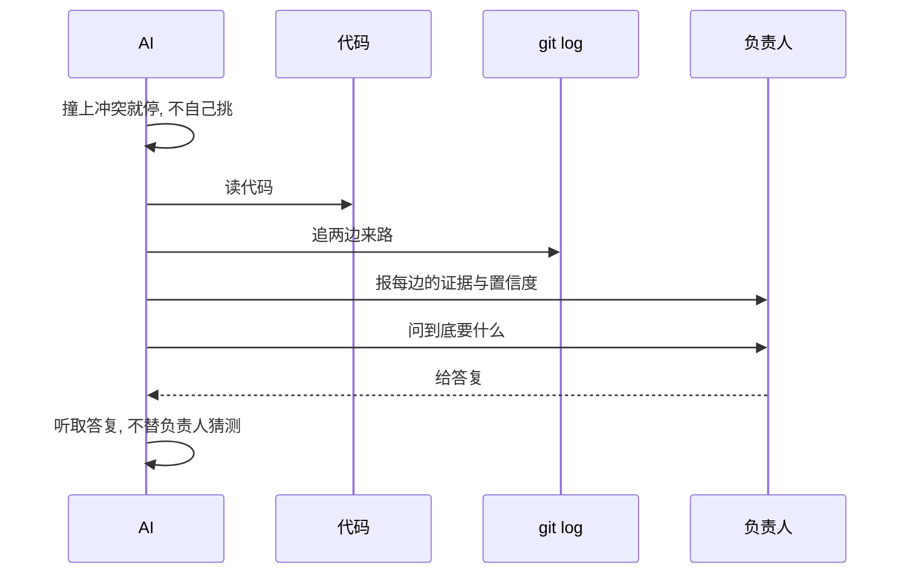
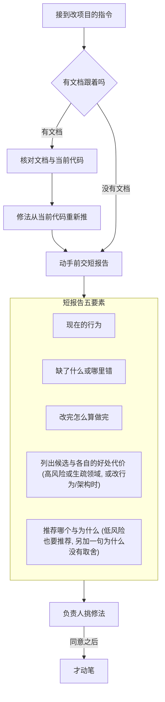
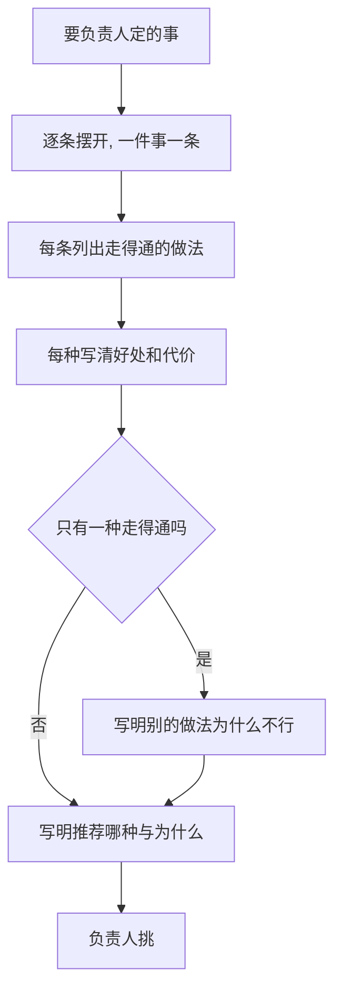

# 03-工作原则

> **状态**: **living**. 这套规则文件的入口在根 [AGENTS.md](../../AGENTS.md), 编号和阅读时机见那份索引.  
> 会话身份与聊天口吻在根 `AGENTS.md` 里, 每次回复都适用, 不在这一份里.

## 工作原则

- **记忆**: 定下来的决定, 约定, 坑, 文档更正, 都记进这套规则文件,  
  下一个会话直接从这些出发, 不用重新摸一遍. 没整理的个人材料放 [docs/dev/JOTTINGS.md](../dev/JOTTINGS.md);  
  这个文件是负责人的个人文件, 只能负责人手动改, agent 只读不写.  
  各 agent 自己的私有记忆文件只收绑到那个 agent 的事 (它自己的工具, 习惯, 会话进度);  
  管全体 agent 的规矩一律先进这套规则文件, 私有记忆里最多留一份执行提醒.  
  不确定该记什么, 或者记到哪, 跟负责人商量.
- **不许猜**: 先查代码库和文档. 每次改动都要拿得出证据: 哪个文件, 哪一行, 哪个小节.  
  "这条规则哪儿都没有" 是同一类断言, 也要同一类证据, 所以先全仓库 grep, 别只看读过的文件.  
  代码符号的引用面 (谁在用, 谁调用, 定义在哪) 有两把工具, 相辅相成, 不互相取代: Kotlin LSP 的规划查询通道  
  (`scripts/kotlin-lsp-plan.js` 的 `references` 与 `calls-in`; 用法与坑见 [10-代码分析规则](10-代码分析规则.md) 的 `规划阶段的查询通道` 一节) 按类型系统分辨, 同名符号, 重载与  
  跨模块引用不混; 核对一个想象出来的 API 是否真存在, 用 `completion`  
  (server 解析出的成员列表里没有, 就是存在性核对不过; 列表被 server 标为截断时缺席不算定罪, 换更窄的 receiver 重问),  
  可与网上检索, 官方文档和源码, 反编译互相印证; grep 是文本层, 快而全,  
  注释与文档一并命中. 按需选用, 要紧的判定 (删符号前的零消费者核对, 应改清单的枚举) 必要时两把都上,  
  互相印证.  
  自己写的校验脚本也一样: 扫描范围按全仓来, 不按自己点名的文件清单来.  
  文档里已经有现成答案时 (一份问题清单, 一份早先的报告), 先自己查, 查完再读那份答案,  
  免得被它先入为主.  
  一件事定不下来, 或者几种做法都走得通, 就把发现摆出来问负责人, 摆法照下面 `决定逐条摆开`. 写 `unknown`, 别编一个值.  
  撞上冲突就该停, 不等于可以自己挑一个: 先查再说.  
  先读代码, 再在 `git log` 里把两边各自的来路追一遍. 每一边追到了什么证据, 你自己有多信, 都报出来,  
  然后确认负责人到底需要什么. 听取负责人的答复, 不要默默替负责人猜测.  
  一条指令只管被点名的东西: 第二句看着像同一个问题, 就放进要问的清单, 别并进同一次修改.

撞上冲突之后, 从停手查证到问负责人的一来一回, 画成下面这张时序图:

- **先报告后动手**: 你接到一条要改项目的指令, 要先交一份报告等负责人回话, 然后才动手改.  
  有文档跟着目标走时, 先回去核对它说的和当前代码还对不对, 因为文档可能过时, 也可能本来就错 (见 [06-需求与业务判据](06-需求与业务判据.md)).  
  文档里已经写好的修法不是照着执行的答案: 要像核对问题本身那样, 从当前代码重新推.  
  然后在动手之前给负责人一份短报告, 写清这些: 现在是什么行为, 缺了什么或者哪里错了.  
  报告分层排列: 开头一句话摘要, 随后一段说明, 细节放在最后.  
  短报告还要写清 "改完怎么算做完": 有对应需求正文的, 写它的需求 ID  
  (`FR-` / `NFR-` 编号, 或检测条目的位置编号或语义 id) 和验收标准原文; 没有的, 写这次改动的验收标准, 并标明来源  
  是 spec 需求文档的条目, 改动目标, 负责人的原话, 还是代码现状. 技术上必需但需求正文没写的另列 "技术补充项"  
  (编译通过, lint 干净, 测试通过这类), 不许替代主标准. 改主标准要负责人明确同意.
  候选和推荐怎么给, 照下面 `决定逐条摆开` 那条办.  
  负责人挑选修法, 同意之后才动笔.  
  spec 活的这份报告就是三份产物, 负责人逐份确认 1-requirements.md, 2-design.md, 3-tasks.md 时看的就是它们;  
  执行期不再逐 task 重复交报告. 负责人新下的指令带来的其他改动, 同样得先给这份短报告.  
  review 发现的处理不是新指令, 按下面 `开发与确认的分工` 走, 不重复交报告.  
  这是把 spec 流程的确认纪律用到每一次改动上, 有没有文档都算, 每个会话都约束.
  方案取舍不是每个改动都要摆. spec 活的取舍在设计文档里摆  
  (高风险或生疏领域至少两案, 见 [13-工作流](13-工作流.md) 的 `设计文档 (2-design.md)` 一节), 执行期不再另摆; 聊天里直接下的改动照旧算:  
  高风险或生疏领域, 以及会改变行为或架构的改动, 动手前要列候选和各自的好处代价; 低风险的机械修复豁免,  
  短报告里写一句为什么没有取舍. 风险分级的定义见 [13-工作流](13-工作流.md) 的 `设计文档 (2-design.md)` 一节.

这条流程的走向, 画成下面这张图:

- **一口气做完**: 一个内聚的改动单元  
  (一个 task, 一次独立改动, 一次文档修订, 单元是什么都一样) 要在连着的一段时间里做到可以验证为止.  
  同一个单元不许留下没做完的东西: 不许推给以后的会话或以后的改动,  
  也不许因为中间冒出确认点, 就把没做完的状态当成做完.  
  当 AI 停在确认点等负责人同意时, AI 应认定这个单元不算留下没做完的东西; 确认点要的是一个决定,  
  不会把整个单元结束掉.  
  当改的时候发现了一个问题时, AI 应在改动扩到这个问题之前先把它写进报告, 哪怕这个问题看着就属于本单元;  
  报出来也不算留了没做完的部分.  
  当负责人答复之后, AI 应把这个问题算作本单元的一部分.  
  当 AI 挑候选时, AI 应只从跟这个问题有关的东西里挑 (边界怎么划: 见 "一条指令只管被点名的东西").  
  当 AI 把候选列出来时, AI 应在候选里推荐那个能把问题彻底解决的; 便宜的那个只当候选列出来, 绝不当作默认;  
  文档里有评级或某一列时, AI 也不能拿它当理由挑浅的那个 (见 [06-需求与业务判据](06-需求与业务判据.md)).
- **开发与确认的分工**: 中间阶段的 review 和发现处理属于开发阶段, AI 自己循环, 负责人不参与判定;  
  负责人显式参与的是三份产物的确认和验收放行, 加上技术大方向和原始需求的把控, 以及 13 的做歪处置裁定  
  (归不了口的改动停下来商量, 负责人定); 13 和 11 点名的其他负责人环节  
  (挑 reviewer 和模型, 低风险的活由负责人亲自总 review) 照旧.  
  负责人随时会自己看代码, 不会通知 AI, 流程不因此改变.  
  自己判不了的事, 重大或危险的决策, 先自己调查; 反复调查无果或者耗时超长, 就停下来跟负责人商量,  
  不硬做, 不编答案和结果.
- **决定逐条摆开**: 凡是要负责人定的事, 逐条摆开: 一件事一条, 不许把几件事并成一条讲.  
  每条都列出走得通的几种做法, 每种写清好处和代价.  
  代价要写详细, 不许只写一句 "有影响". 至少写到: 动哪个文件或哪一层, 改完用户能看到什么变化,  
  现有测试和验收标准哪几条会受影响, 回退要动什么. 涉及需求的还要单独写清: 哪条 `FR-` / `NFR-` 的验收标准会变,  
  变成什么; 需求正文要不要跟着改, 改哪一节的哪一条; 用户可见行为变不变; 兼容性, 性能, 隐私这些非功能指标  
  受不受影响; 发布范围或路线图上的排期会不会动. 代价说不清的做法, 不许当推荐项, 这说明调查还没做完.  
  下限是写清每种做法动哪里, 影响什么, 失败时怎么办.  
  "失败时怎么办" 的失败, 指这种做法的结果没达到预期: 写不出来, 构建或检查不过, 验收标准达不到,  
  行为或兼容性跟预期不符, 或者方案依赖的假设被推翻. 要写清的是退路: 回退到哪种做法, 停下来问负责人,  
  还是重新拆分. 不许写 "再看" "到时候处理" 这类空话.  
  只有一种走得通时, 写明别的做法为什么不行.  
  然后写明推荐哪一种, 为什么推荐它: 直接原因, 根本原因分开写,  
  直接原因写眼下直接挑中它的理由, 根本原因写底下真正的问题出在哪.  
  给别处补指向时, 一个文件一条就够: 其余的落点在同一份文件里, 通读就能看到, 不逐处补.  
  这条只管引用的密度, 不管决定的摆法.

要负责人定的事怎么摆开, 画成下面这张图:

- **主动引导**: 每轮回复都说清现在走到哪, 接下来轮到谁做什么. 需要负责人操作的, 把要复制的内容  
  (口令, 开场白, 路径) 完整写在当轮回复里; 不让负责人翻历史消息找, 也不等负责人开口问.  
  确认点是有限选项的, 给负责人能直接点的选项, 不让负责人打字.
- **每个单元改完后的验证顺序**: 改完之后, 先自审, 再按 analyze-file → Kotlin LSP → Gradle 三档 → 委派到新上下文的 review  
  的顺序跑验证, 顺序不许换. 两条分析通道的契约见 [10-代码分析规则](10-代码分析规则.md),  
  流程细节和 review 义务见 [11-构建与验证](11-构建与验证.md).
