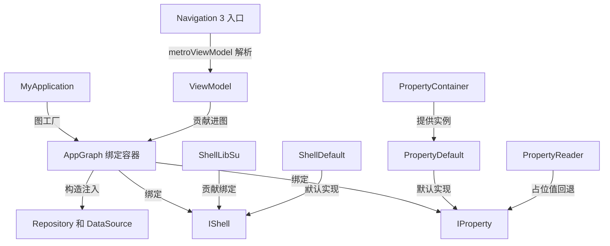
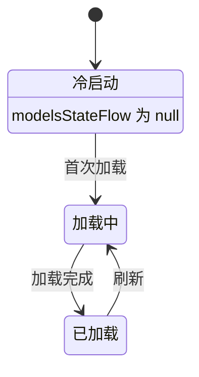
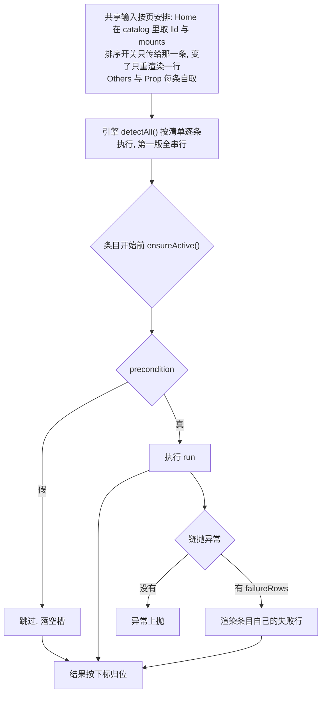
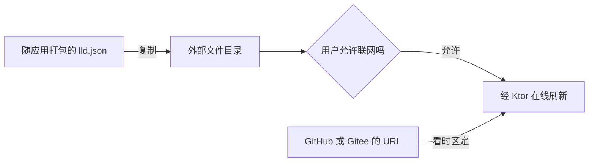

# 05-项目架构

> **状态**: **living**, 是 [04-项目概览](04-项目概览.md) 架构那节的细则部分.  
> 改导航, DI 图, 某个 ViewModel 或状态类, 列表页, 设置持久化, 或者 shell 和属性访问之前, 先读这份.  
> 一句话的决定写在 04-项目概览 里, 细节和原因写在这里.

每个界面长什么样不再单独成文: 直接读 `ui/` 下的代码. 这份文件写跨功能和跨层的决定, 以及每个决定为什么这样定.

## 导航

导航用 **Navigation 3** (`androidx.navigation3`), 不是主流的 Navigation 2.  
API 的形状是 `NavKey` 加返回栈加 entryProvider, 代码在 `ui/navigation/NavKeys.kt`.  
别按 Nav2 的思路想, 例如别去找 `NavHost(route = ...)`.

## 依赖注入

DI 用 **Metro**: 编译期完成, 不走反射. 这是对 Hilt 和 Koin 这些主流做法的有意偏离.  
手写 companion `Factory` 和 `viewModel(factory = ...)` 的老写法已经退役.  
ViewModel 这么写: `@Inject` 加 `@ViewModelKey` 加 `@ContributesIntoMap(AppScope::class, binding<ViewModel>())`,  
再在 Navigation 3 的入口用 `metroViewModel<...>()` 解析. Repository 和 DataSource 就是普通的 `@Inject` 构造注入.  
叶子绑定放在 `di/AppGraph.kt` 的绑定容器里, 图工厂绑定 `MyApplication`.  
图里不要声明 companion 对象: 原因, 报错原文和复查办法在 `di/AppGraph.kt` 工厂上方那段注释里.  
Gradle 插件, 运行时和 MetroX 构件都锁到 `gradle/toml/thirdParty.toml` 里同一个 `version.ref`.  
升 Kotlin 就得配套升 Metro, 所以先查官方兼容性矩阵.

延迟注入的位置用函数类型 `() -> T`, 不用 Metro 的 `Provider<T>`.  
Metro 默认就把 `() -> T` 当 provider, 而写出来的 `Provider<T>` 正是它自己会报告的那种不受鼓励的语法糖,  
检查项是 `DESUGARED_PROVIDER_WARNING`. 这条检查读的是声明类型, 不看这个值实际怎么被调用.

依赖注入和接口绑定合起来看, 各处绑定怎么声明和解析, 画成下面这张图:

## 设置归属

设置归 `SettingsStore` 所有, 文件在 `ui/settings/repository/SettingsStore.kt`.  
每一项设置的键, 值和全部写入口都集中在这一个类里, 也只有这里能观察到这些值.  
消费者从依赖图里拿到注入的 `SettingsStore`, 所以它之外没有任何代码直接碰 SharedPreferences.  
图里那个 SharedPreferences 绑定, 只是为了给它提供实例.

## 接口优先的可测试性

不好直接碰的依赖都收在接口后面: `:base` 定义 `IProperty` 和 `IShell`,  
各带一个默认实现 (`PropertyDefault` 和 `ShellDefault`), 也没有聚合类. 图把两者都绑定:  
`ShellLibSu` 用 `@ContributesBinding` 贡献 `IShell`, `PropertyDefault` 由 `PropertyContainer` 用 `@Provides` 绑定.  
`PropertyReader` 在 `ui/common`, 在 `IProperty` 外面包了一层共用的占位值回退.

接口优先让替身好写: 依赖是接口, 就能塞一个手写的假实现, 不必引框架.  
MockK 只在要验证交互 (调用参数, 次数, 顺序) 时才用, 不用它绕开本该走接口的地方.

测试栈统一 JUnit 4. 本机单测与仪器测试都用 JUnit 4, 本机侧由版本目录的 `junit` 键给出,  
断言用 `org.junit.Assert`; 仪器测试留在 JUnit 4, 因为设备侧的 `AndroidJUnitRunner` 与  
`androidx.test.ext:junit` 都是 JUnit 4 系, 那份 JUnit 4 由这两个构件传递带入, 不经过版本目录.  
仪器测试的测试方法名不许用带空格的反引号名: 方法名要进 DEX, minSdk 给不到 DEX 040 时  
d8 直接红 (`Space characters in SimpleName ... not allowed`), 用驼峰命名.  
本机单测没有这层约束, 反引号名照常用.  
两套测试依赖都由约定插件的 `configureTest()` 统一挂, 模块自己的 `build.gradle.kts` 不重复声明.

Robolectric 在本机单测里模拟 Android 框架, 让检测条目的单测能进 CI. 它用原生 runner  
(`@RunWith(RobolectricTestRunner::class)`) 加载, 接线有三样, 都由 `configureTest()` 统一给:  
`isIncludeAndroidResources` (没有它, 合并资源解析不出来, 资源类测试直接红), 加两个测试 JVM 开关:  
`--add-opens` (新 JDK 的模块封装挡了 Robolectric 的 FileDescriptorInterceptor) 与  
`--enable-native-access`. `RobolectricSpikeTest` 是原生 runner 的常驻冒烟,  
升级 Robolectric 或 AGP 之后先看它.

逐条单测用哪套手段, 按被测行为的性质定, 逐项裁量后进裁量表:

| 被测行为 | 手段 | 原因 |
|---|---|---|
| 真实 shell, 真实 `/proc`, 真实包管理器 | 仪器测试 | 模拟环境给不出真值 |
| Settings, SharedPreferences, 资源文案, `Build.*` 静态字段分支, 普通系统属性, mapper, ViewModel | Robolectric | 假环境覆盖这些 API 的行为, 能进 CI |
| 依赖厂商改过的具体属性值, 以及两者都测不到的 | 探针假值, 报告写明 | 与 subtask-04 报告的裁量标准一致 |

真机行为另有每次修改的黄金快照对照, 逐条单测补的主要是 CI 覆盖.

## BaseListViewModel

`BaseListViewModel` 管每一个列表页, 靠两个 `StateFlow`:  
`modelsStateFlow: StateFlow<PersistentList<MyModel>?>` 和 `isLoadingStateFlow`.  
`modelsStateFlow` 为 null 表示冷启动. 刷新时故意留着上一次的列表, 界面永远不会闪成空白.  
`loadJob` 负责去重, 所以重建时不要再引入多余的加载.

那个 `PersistentList` 只在这个边界上由 `setModels()` 构建一次,  
之后由 `updateModelDetail()` 用 `PersistentList.replacingAt()` 就地修补 (`set()` 已废弃).  
这个修补入口按 `MyModelType` 找行: 列表为空时不动, 找不到那种行时也不动.  
Home 的排序开关就靠它: 开关一变只重渲染那一行, 不重跑检测 (见下面的检测执行模型).  
composable 从不转换这个集合: 转换写在 composable 正文里, 该作用域每次重组都会重跑一遍 `O(n)`.

两个 StateFlow 撑出来的加载状态和转换, 画成下面这张状态图:

## 检测执行模型

检测条目在 `ui/base/detect/Detector.kt` 里是一条数据: 语义 id, 要执行的链, 可选的 `precondition`  
与 `failureRows`. 三页各有一份清单: Home 的在 `ui/home/detect/HomeDetectorCatalog.kt`,  
Others 的在 `ui/others/detect/OthersDetectorCatalog.kt`,  
Prop 的在 `ui/prop/detect/PropDetectorCatalog.kt`. 清单的顺序就是展示顺序;  
[检测条目目录](../requirements-cn/04-检测条目目录.md) 的行序也必须是这个顺序.

引擎 `List<Detector>.detectAll()` 只管按清单逐条执行: 结果按下标放进固定大小的数组,  
谁先跑完都不影响展示顺序. 共享输入不归它管, 三页各自安排:

- Home: `HomeDetectorCatalog.detect()` 里一次取齐: `LldLoader` 的 lld (连失败原因), `mounts`,  
  以及排序开关的当前值 (只传给那一条条目). 排序开关是展示参数, 不是检测输入:  
  它变了不重跑检测, 只重渲染 `HOME_OUTDATED_TARGET_SDK_APK` 那一行.
- Others 与 Prop: 没有共享输入, 每条自己取.

第一版全部串行, 先把清单, 顺序和取消做对. 有界并发要等 `ShellLibSu` 能否并发调用查清楚才做,  
那时的候选是 "读属性与纯计算的条目并发, 走 shell 的条目串行". 现在不预先造调度器.

每个条目开始前检查一次 `ensureActive()`. shell 命令本身不能中断, 所以取消要等到命令返回,  
不能承诺 "随时可取消".

链抛异常时, 传了 `failureRows` 的条目渲染自己的失败行; 传 null 的条目让异常照原样上抛,  
Others 与 Prop 的仓库自己 guard, 走的是这一条. `CancellationException` 一律上抛.

`precondition` 把平台版本判断写成数据, 引擎在条目开始前判它, 为假就跳过并落一个空槽.  
条目调的 API 有版本要求时, `run` 里也要有一句同样的运行时判断, 让 Android lint 看得见;  
没有版本要求时, `precondition` 一处就够. 两处都写的那种条目, 判断同源, 改一处就要改另一处.

执行模型画成下面这张图:

## Compose 稳定性

Compose 的稳定性注解 (`@Immutable` 和 `@Stable`) 是有意加的. 状态类一改动, 就重新评估这些注解.  
照着 `HomeViewModel` 和 `BaseListViewModel` 顶部注释里的示范做, 那条注释解释了为什么这个注解在这里是安全的.

## Lld.json 数据流

随应用打包的 `lld.json` 会复制到外部文件目录 (`LldFileStore`). 用户允许联网时, 它经 Ktor 在线刷新.  
用 GitHub 还是 Gitee 的 URL, 看时区定.

实际跑检测用哪一份, 由 `ui/home/datasource/LldLoader` 的三级回退决定: 允许联网就现在线那份,  
拉取或解析失败退到私有目录的副本, 副本也不行就用随包的那份. 它不抛异常, 每次失败作为  
`LldFailure` 的原因 (拉取, 解析, 写入) 带回去; 行上的文字由 `HomeModelMapper` 拼.  
连随包那份都读不出来时 lld 为 null, 那一行按未知渲染, 不崩.

lld.json 的来路, 画成下面这张图:

## Shell 执行

命令执行用 libsu 的 **non-root** 模式, 代码在 `ui/common/ShellLibSu.kt`, 带 `Shell.FLAG_NON_ROOT_SHELL`.  
这个应用没有 root 层.
