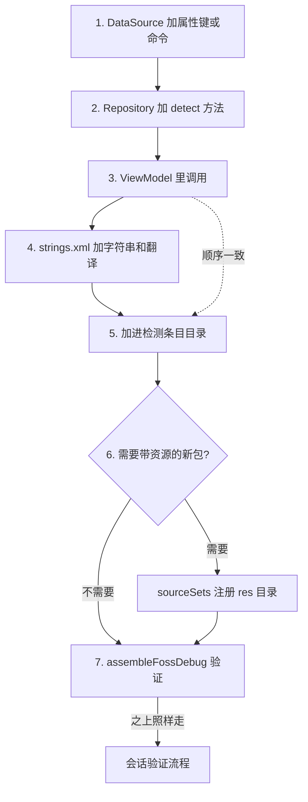

# 06-检测条目

> **状态**: **living**. 给任何功能加检测条目之前先读这份;  
> 阅读时机登记在根 [AGENTS.md](../../AGENTS.md) 的索引表里.

流程 (列表顺序 = 调用顺序):

1. 给这个功能的 `DataSource` 加属性键或 shell 命令.
1. 给这个功能的 `Repository` 加一个 `detect...()` 方法, 返回 `MyModel`.  
   新的 Repository 和 DataSource 类靠 `@Inject` 构造器注入进依赖图.  
   少这个注解, 构建会以 `[Metro/MissingBinding]` 失败.
1. 在功能 ViewModel 构建列表的地方调用它. Others 和 Prop 是 `collectModels()`, Home 是它调用的 `detect()`.  
   调用顺序决定列表顺序.
1. 把字符串加到这个功能包的 `strings.xml` (默认英文), 以及三个翻译文件.
1. 把这个条目加进[检测条目目录](../requirements-cn/04-检测条目目录.md).  
   在这个屏的表里加一行; Home 的条目还要加定义块, 写 `question`, `techniques` 和 `tri-state semantics`.  
   目录里的顺序就是第 3 步的调用顺序.
1. 这个条目需要带资源的新包时, 去 `app/build.gradle.kts` 的 sourceSets 里注册它的 res 目录.
1. 用 `./gradlew assembleFossDebug` 验证. 这一步只覆盖这次变更本身;  
   约束每个会话的那套验证流程在它之上照样要走完 (见 [11-构建与验证](11-构建与验证.md)).

这 7 步的先后走向和两处约束, 画成下面这张图:

