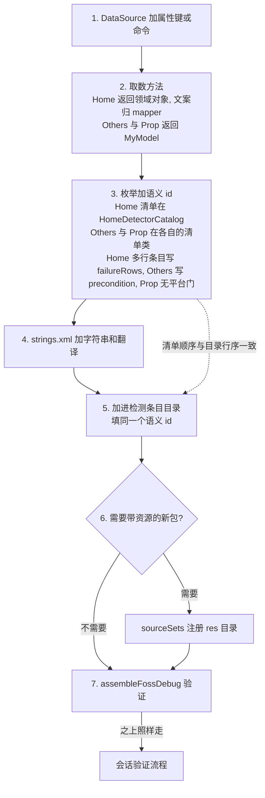

# 08-检测条目

> **状态**: **living**. 给任何功能加检测条目之前先读这份;  
> 阅读时机登记在根 [AGENTS.md](../../AGENTS.md) 的索引表里.

每个检测条目是一条数据, 三页各有一份清单, 清单的顺序就是展示顺序.  
加一个条目要走下面这 7 步; 第 2 与第 3 步 Home 与 Others/Prop 不同, 分开写:

1. 给这个功能的 `DataSource` 加属性键或 shell 命令.
1. 加取数方法:
   - Home: 给 `HomeRepository` 加一个 `detect...()` 方法, 返回 `DetectResult<领域对象>`.  
     领域对象放 `ui/home/model/`, 只装事实与判断, 不带文案与颜色; 文案与颜色写在  
     `HomeModelMapper` 的 `to...Model()` 里, 判断留在仓库, 文案与颜色归 mapper.  
     mapper 是纯函数, 自己不做失败隔离: 条目链抛异常时的失败行由引擎的按条目 guard 出  
     (见 [07-代码规则](07-代码规则.md)).
   - Others 与 Prop: 给 `OthersRepository` / `PropRepository` 加一个 `get...()` 方法, 返回 `MyModel`,  
     失败隔离照 `ui/base/list/MyModelExt.kt` 的 guard 家族写.
   新的 Repository 和 DataSource 类靠 `@Inject` 构造器注入进依赖图.  
   少这个注解, 构建会以 `[Metro/MissingBinding]` 失败.
1. 给这个条目取一个语义 id, 并把它加进功能页的清单:
   - 语义 id 加在功能页的条目枚举里: Home 是 `ui/home/model/HomeEntryId.kt`,  
     Others 是 `ui/others/model/OthersEntryId.kt`, Prop 是 `ui/prop/model/PropEntryId.kt`,  
     形如 `home-kernel`, `oth-brand`, `prop-build-prop`. 枚举的声明序就是展示序.
   - Home: 清单在 `ui/home/detect/HomeDetectorCatalog.kt` 的 `detect()` 里, 一条一个 `detector(...)`,  
     形如 `detector(HomeEntryId.HOME_KERNEL, { repository.detectKernel(lld) }) { ... }`.  
     单行条目由翻译自己喂失败行; 两条多行条目改用 `rawDetector(...)`, 自己写 `failureRows`.
   - Others 与 Prop, 清单在各自的清单类里: Others 的在 `ui/others/detect/OthersDetectorCatalog.kt`,  
     Prop 的在 `ui/prop/detect/PropDetectorCatalog.kt`. 一条一个 `rawDetector(...)`,  
     形如 `rawDetector(OthersEntryId.OTH_BRAND) { ... }`. 这两页的仓库自己 guard,  
     条目不传 `failureRows`, 链抛异常时照原样上抛; Prop 现在没有平台门.
   - 这个条目要按平台版本决定出不出行时, 判断写成 `precondition`; 条目调的 API 有版本要求时,  
     `run` 里再留一句同样的运行时判断, 因为 Android lint 看不见写在数据里的判断;  
     没有版本要求时, `precondition` 一处就够. 两个字段的含义见 `ui/base/detect/Detector.kt`.
1. 把字符串加到这个功能包的 `strings.xml` (默认英文), 以及三个翻译文件.
1. 把这个条目加进[检测条目目录](../requirements-cn/04-检测条目目录.md).  
   在这个屏的表里加一行, 语义 id 填第 3 步那一个; Home 的条目还要加定义块,  
   写 `question`, `techniques` 和 `tri-state semantics`.  
   目录的行序与第 3 步清单的顺序必须一致. 单测 `DetectionEntryOrderTest` 锁枚举的声明序,  
   它里面那张期望表是目录行序抄下来的副本: 改目录的行序, 同一次改动里就要改那张期望表.
1. 这个条目需要带资源的新包时, 去 `app/build.gradle.kts` 的 sourceSets 里注册它的 res 目录.
1. 用 `./gradlew assembleFossDebug` 验证. 这一步只覆盖这次变更本身;  
   约束每个会话的那套验证流程在它之上照样要走完 (见 [11-构建与验证](11-构建与验证.md)).

这 7 步的先后走向和两处约束, 画成下面这张图:

