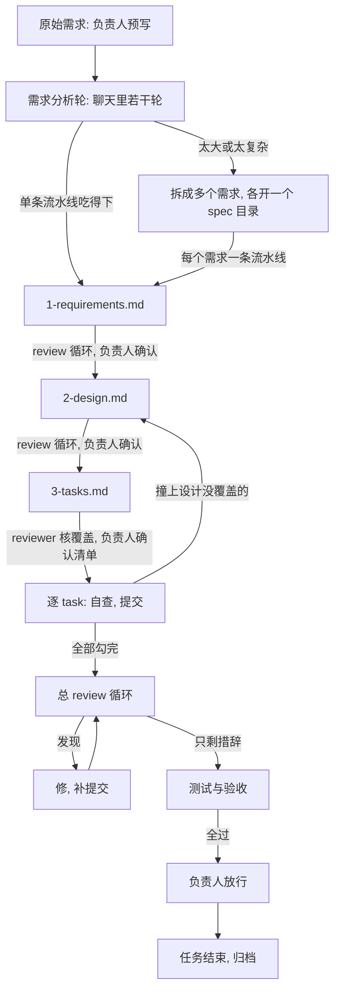
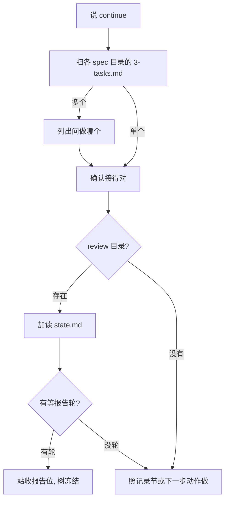

# 13-工作流 (docs/spec)

> **状态**: **living**, spec 工作流的细则.  
> 开 spec 目录之前, 进入一个新阶段 (需求分析, 三份产物的起草与确认, 执行, 总 review, 测试与验收) 之前,  
> 宣布任务关闭之前, 负责人说 continue 要接续之前, 都把这份文件完整读一遍.

## 全景

一条需求从原始需求到归档的走向, 画成下面这张图; 图装不下的细则按节排:

拆分只有一层: task. task 是执行和提交的最小单元, 再往下不再分层.  
`task` 与 [14-跨端 Review](<14-跨端 Review.md>) 里 session/task 的 task 撞名: 那边说的是委派形式,  
这边说的是任务清单里的一格, 说不清时写 task-N.  
subtask, substep, 批, 组 (作层级用时), `plan.md`, `progress.md` 都是已改掉的写法,  
对照表见 [02-聊天与文档排版规则](02-聊天与文档排版规则.md) 的 `本仓库改过名的术语` 一节.  
[12-Git](12-Git.md) 说的 "单元" 指 task.

## 确认与接续 (每个会话都要守)

负责人就是开发者本人. AI 做搜索, 分析, 编码, 测试, review. 目标, 边界, 提交, 这三样负责人定;  
技术判断 AI 做, 撞上大方向或需求正文时停下来问.  
每个确认点都以负责人的明确同意收尾: 负责人没明确同意就不提交 (走不走 spec 流程都一样),  
没同意也不许开下一步. push 和删除的同意永远单独给, 一次确认只管一件事;  
唯一的成批授权是 `3-tasks.md` 那次确认, 它同时授权清单内各 task 的提交, 边界写在 [12-Git](12-Git.md).  
每个 spec 目录带一份 `3-tasks.md`: 顶部记录节加任务清单. AI 在每个确认点更新记录节,  
勾选框随每个 task 更新, 两者跟着提交入库; 执行期的状态就是勾选框, git 提交历史负责每笔改了什么.  
会话一开始, 或者负责人任何时候说 "continue", 就扫一遍 `docs/spec/*/` 找没做完的活:  
目录里有 `3-tasks.md` 的, 看未勾的 task 和记录节的下一步动作. 改造前的旧三层目录曾带 `progress.md`  
  (已删, 原文见 git 历史); 现行 spec 目录一律以 `3-tasks.md` 为准. 负责人要记住的只有那一个词.  
动手之前先跟负责人确认这次接得对不对, 只剩一个没做完的活也要确认.  
同时有好几个没做完时, 列出来问做哪个.

接续时的走向, 从扫目录到 review 目录分岔, 画成下面这张图:

## 目录与文件布局

- 目录名叫 `docs/spec/<yyyy-MM-dd-HH-mm-ss-Z>-<english-title>[-cn]/`. 时间戳取宿主机时钟, 标题用简短的英文.
- 结尾的 `-cn` 表示里面的报告不是英文. 这些目录里的文件按规定名存放, 一律不再加语言后缀.
- 文件三种, 序号 1, 2, 3 标内容确认的先后 (骨架可以先建, 确认照序走): `1-requirements.md` (需求文档),  
  `2-design.md` (技术方案设计), `3-tasks.md` (记录节加任务清单).  
  三份各自声明 living; 目录移进 `docs/spec/archived/` 时被位置取代  
  (状态模型见 [01-聊天与文档内容规则](01-聊天与文档内容规则.md)).
- `3-tasks.md` 的骨架 (记录节加空任务清单) 随 spec 目录一起建, 随 `1-requirements.md` 的确认提交一并入库:
  - 记录节从第一天就有去处.
  - 任务清单的 task 在 `2-design.md` 确认后起草, 整份 `3-tasks.md` 的确认点不变.
- 三份产物和记录用什么语言, 负责人按活逐个定, 定了就在目录名加 `-cn`.
- 不再有 `plan.md`, `subtask-NN.md`, `progress.md`; 改造前的旧目录曾带它们, 原文见删除前的 git 历史.

## 原始需求 (负责人预写, AI 开始之前)

负责人手写 2-3 句话, 说清三件事: 问题是什么, 自己打算怎么做, 预计最大的风险在哪.  
这三句原文放进 `1-requirements.md` 开头的 `原始需求` 一节, AI 不改它, 任务结束时拿它来对照.

这一步防的是: 先看了 AI 的分析, 自己的判断就被带着走 (锚定效应和后见偏差, Tversky & Kahneman).

## 需求分析 (聊天里的若干轮)

- AI 拿证据反问 (照 [03-工作原则](03-工作原则.md) 的 `不许猜`), 每轮收在一组问答;  
  结论全部收进 `1-requirements.md`, 问答本身不落盘.
- 需求分析轮里同时判大小: 单条流水线吃不吃得下. AI 拿证据提出拆分建议 (拆成哪几个需求, 各自边界, 依赖关系),  
  负责人定; 拆出的每个需求独立开 spec 目录走全流程, 依赖写进各自的 `1-requirements.md`.
- 深度按活浮动: 功能类写全; 重构, 机械类的需求分析三五行就够 (现状问题加目标状态).

## 需求文档 (1-requirements.md)

- 开头 `原始需求` 一节放负责人预写的原文.
- 需求条目每条一个编号 `R-1`, `R-2`, ... `R-` 编号只在它自己的 spec 目录里有意义,  
  引用全局需求时另标 `FR-` / `NFR-` 编号. 每条写:
  - 要什么: 一句需求句.
  - 验收标准: 主标准逐条引需求正文 (docs/requirements-cn) 的原文, 标明 `FR-` / `NFR-` 编号,  
    或检测条目的位置编号或语义 id, 不许改写; 全局需求正文没覆盖的条目, 主标准从原始需求取, 标明来源.  
    技术上必需但需求没写的另列 "技术补充项", 不许替代主标准; 改主标准要负责人明确同意.
  - 映射的全局需求 ID (如有).
- 只写做什么和怎么算做完, 不写怎么实现 (那是 `2-design.md` 的事).

确认走 `文档 review 循环` 那一节; 负责人确认之后自动提交 `1-requirements.md`.

## 设计文档 (2-design.md)

- 技术方案设计: 动哪些模块, 数据怎么流, 关键取舍与风险, 生疏领域标出来.
- 风险分级: 高是安全, 数据, 核心逻辑或生疏领域; 低是机械性和样板. 分级定的是取舍要不要摆两案,  
  review 的分量也照它走.
- 方案取舍: 高风险或生疏领域的设计点, 必须给出至少两种做法和各自的好处代价, 摆法照  
  [03-工作原则](03-工作原则.md) 的 `决定逐条摆开`; 低风险的设计点写一句 "无方案取舍" 加理由.
- 覆盖映射: `2-design.md` 带一份 `R-` 编号到设计节与 task 的覆盖映射; 覆盖核对拿它对照,  
  每个 `R-` 都有设计节与 task, 每个 task 都标它落实的 `R-`.
- 末尾附一份待学习清单.
- 不写任务切分 (那是 `3-tasks.md` 的事).

确认走 `文档 review 循环` 那一节; 负责人确认之后自动提交 `2-design.md`.

## 任务清单 (3-tasks.md)

- 顶部 `记录` 一节, 按时间追加: 偏差 (哪个阶段或哪个 task, 跳了哪一步, 为什么), 挂起项,  
  各轮判定 (结果与理由), 验收结果, 下一步动作.
- `任务清单` 一节里每个 task 一条, 带勾选框, 交代清楚:
  - 目标一句.
  - 凭什么是独立 task: 改动最小, 内聚度高, 能独立编译, 单独验证得起来; 共用骨架与纯新增的辅助各成一笔  
    (照 [12-Git](12-Git.md) 的单元算法).
  - 动哪些文件.
  - 怎么验证: 命令级, 照 [11-构建与验证](11-构建与验证.md) 的命令.
  - 对应 `2-design.md` 的哪一节, 落实哪些 `R-` 编号.
- task 拆到执行时不需要做决定, 拿到就能干; 执行时要做决定, 说明设计还没做完, 回 `2-design.md`.  
  不把几个可独立验证的 task 并成一条; task 不能省: 三两句话就带过的 task, 等于把整件事塞回一个单元,  
  设计就白做了.
- reviewer 确认之前核覆盖: 每个 `R-` 编号都有设计节和 task, 每个 task 都有归属; 漏一项算实质发现.

确认走 `文档 review 循环` 那一节; 负责人确认 `3-tasks.md` 的那一次同意, 同时是清单内各 task 的提交授权  
(边界见 [12-Git](12-Git.md)). 确认之后自动提交 `3-tasks.md`.

## 文档 review 循环 (三份产物共用)

- 每份产物确认之前走同一套: AI 先自审一遍, 再让一个新上下文的 reviewer review;  
  每修完一轮往后排一轮 (v1, v2, ...); 发现 AI 自己判 (实质问题修, 措辞问题顺手改, 归别处的记下);  
  只剩不重要的措辞问题时 reviewer 停, 交负责人确认.
- 各自的参照物: `1-requirements.md` 对照原始需求和需求正文  
  (docs/requirements-cn, 检测条目目录见 [04-检测条目目录](../requirements-cn/04-检测条目目录.md));  
  `2-design.md` 对照 `1-requirements.md`; `3-tasks.md` 对照 `2-design.md` 和 `1-requirements.md`.
- reviewer 的义务照 [11-构建与验证](11-构建与验证.md): 每条发现带能核对的证据 (file:line),  
  落盘报告前先自检一轮; 模型和 effort 负责人定. 某一轮交给另一家 ADE/IDE 时照  
  [14-跨端 Review](<14-跨端 Review.md>).
- 这一步防两件事: 需求和设计错了, 执行期全白干; 一次 review 的改动越大, 该改而没改的越容易漏过去,  
  所以三份产物分开确认, 一份一轮. 学习落在确认环节 (自动化的反讽, Bainbridge 1983):  
  负责人跟不上每一行实现, 靠三轮确认和验收跟住方案.  
  增量复核与换新 reviewer 的细则, 照 `总 review 循环` 那一节的同一套.  
  亲自动手实现不算这条流程的一部分: 负责人要学什么, 在流程之外自己安排.

## 执行 (逐 task)

- 一次只做一个 task, 按清单顺序: 实现 → 自查 → 提交 → 勾选框打勾, 记录节补一行.
- 自查: 先自审, 已改的和该改而没改的一起查, 发现问题就改, 改完再自查; 改动要落在这个 task 标的  
  `R-` 验收标准内; 冒出来的范围外想法, 值得做的照下一条停下来回设计, 判定不值得做的记进记录节不做,  
  都不顺手做; 然后按 [03-工作原则](03-工作原则.md) 的验证顺序跑三档检查  
  (analyze-file → Kotlin LSP → Gradle), 全绿才提交.
- 提交: 一个 task 一笔提交, 格式照 [12-Git](12-Git.md); 这笔提交带上它自己的勾选和记录行.
- 执行时不再重新论证需求和设计: 三份文档都过了各自的 review 循环和负责人的确认,  
  对不对的问题已经答过, 执行只负责照单干; 这是负责人说的 "无脑干活" 的含义, 不等于跳过文档的 review.
- 撞上设计没覆盖的东西 (要做的决定不在 `3-tasks.md` 里, 或者照做达不到验收标准): 停下来回 `2-design.md` 补设计;  
  `2-design.md` 的改动照它自己的 review 循环加负责人确认; 任务清单要跟着变时改 `3-tasks.md`,  
  改清单要负责人同意 (授权跟着清单走). 然后回来继续.
- AI 在同一个问题上第二次失败就停下: 交给负责人处理, 或者回设计.
- 注释语言照 [07-代码规则](07-代码规则.md): 实施期间用负责人的聊天语言, 提交之前翻成英语.

## 总 review 循环 (全部 task 勾完之后)

- 让一个新上下文的 reviewer review 从 `3-tasks.md` 确认后第一笔提交到 HEAD 的整串提交;  
  照 `3-tasks.md` 逐 task 找到它对应的提交, 逐条核对.
- 低风险的活, 总 review 也可以由负责人自己做; 高风险与生疏领域照旧委派新上下文的 reviewer.
- reviewer 先照 `3-tasks.md` 和 `2-design.md` 从代码里枚举应改清单, 再对照提交序列找出该改而没改的地方;  
  跟清单无关的改动逐条列成超出范围的发现. 枚举从 `R-` 编号和需求正文的 ID 起步  
  (`FR-`, `NFR-`, 检测条目目录见 [04-检测条目目录](../requirements-cn/04-检测条目目录.md)),  
  然后回代码补齐调用点.
- 覆盖核对, 两个方向都要走: 每个 `R-` 编号都要有设计节, task 和提交里的对应改动; 反过来, 提交里的每一处改动  
  都要能归到某条 `R-` 编号或技术补充项. 归不进去的就是做歪了的部分: 停下来跟负责人商量,  
  摆出回退或补需求条目的建议与各自代价, 负责人定了才动手, 负责人没定之前不继续后续提交.  
  漏一条算实质发现, 不许停. 例外只有一种:  
  负责人已经判定需求正文写错或写过头, 那份判定进例外清单 (记进 `3-tasks.md` 记录节或 review 目录的 `state.md`),  
  清单之外的照实质发现处理.
- 漏改的发现分三档: 本需求该改而没改, 归后续需求或别的活, 需求正文自己写错或写过头. 只有第一档进本轮修改;  
  第二档记进记录节; 第三档判定哪边错归负责人, 负责人先改正文, AI 再回代码. 撞上要停下来商量的情形,  
  照 [03-工作原则](03-工作原则.md) 的开发与确认的分工.
- 每修完一轮, 先对这次修改重跑自查和检查, 然后才进下一轮; 修复作为新的提交入库  
  (授权视同 `3-tasks.md` 清单的延伸, 见 [12-Git](12-Git.md)), 不改写已入库的历史.
- 轮次照 [11-构建与验证](11-构建与验证.md) (v1, v2, ... 每修一轮往后排一轮). 增量复核: 后面的轮次可以续用同一个  
  reviewer 做 delta pass, 它只重读相对自己上一轮变化的部分; 应改清单沿用上一轮那份, 只有 `3-tasks.md` 或 `2-design.md`  
  的对应部分变了才重新枚举. 换回新 reviewer 的时机: 修改重写了大片提交, 负责人否掉了大部分发现,  
  续用的上下文已经臃肿, 或者要做最后一遍独立验收.
- reviewer 换了 session 或换了 ADE/IDE 时, 它没有自己上一轮的会话记忆, 上一轮的报告, 应改清单和两轮之间的修复  
  都从文件带过去, 细见 [14-跨端 Review](<14-跨端 Review.md>).
- 停止条件: 只剩不重要的措辞问题时 reviewer 停, 把发现报上来, 不再要求多一轮;  
  轮次一直在转却没有新发现时, 把这个情况摆给负责人看, 不无限循环下去.
- 这一步防的是执行期没有逐 task review: 方向走偏和漏改在这里抓回, 靠的是对照 `3-tasks.md` 逐 task 核对提交序列.

## 测试与验收 (总 review 循环停了之后)

- 全量跑 [11-构建与验证](11-构建与验证.md) 的四条命令 (assemble, 两组单测, lint).
- 逐条 `R-` 过: 拿 `1-requirements.md` 的每条 `R-` 编号, 对着本次全部修改合起来核它的验收标准,  
  判 满足 / 不满足 / 部分满足, 附证据 (file:line, 命令输出, 快照比对); 核的是需求被满足,  
  不是有一处对应改动就算; 结果记进 `3-tasks.md` 末尾的 `验收` 一节.
- 改动归属: 本次的每一处修改都要能归到某条 `R-` 编号或技术补充项. 归不进去的就是做歪了的部分:  
  停下来跟负责人商量, 摆出回退或补需求条目的建议与各自代价, 负责人定了才动手,  
  负责人没定之前不继续后续提交, 不许留在树里装没看见.
- 按需真机验证: 需求文档点名的, 或者改动碰到界面的.
- 验收有缺口: 有 `不满足` 或 `部分满足` 的条目, 或者有归不了口的改动, 就是缺口;  
  缺的是活, 回执行补 task; 缺的是方案, 回 `2-design.md`. 全过才请负责人放行.

## 负责人放行

- 负责人批准时留一句自己的话, 说这次为什么可以放行; 这句理由写进最后一笔提交的信息  
  (照 [14-跨端 Review](<14-跨端 Review.md>) 的 `报告的归宿` 一节).
- 低风险的活, 验收和放行可以并成一次同意.

负责人留一句自己的理由, 是在把 "眼熟" 升级成 "讲得出为什么" (测试效应, Roediger & Karpicke 2006);  
这能压住 "看着懂了" 和 "以为讲得清" 两种错觉 (Rozenblit & Keil 2002).

## 任务结束

清空待学习清单 (`2-design.md` 末尾那份). 开一次横向回顾: AI 反复做错的是哪几类问题, 收成 review 检查表  
(现状见 [15-review 检查表](15-review检查表.md)).

(间隔效应加元认知校准, 防的是 "我都懂了" 的错觉.)

## 偏差记录

跳过某一步是允许的, 但要在 `3-tasks.md` 的记录节记一行: 哪个阶段或哪个 task, 跳了哪一步, 为什么.

(允许跳过但必须留痕, 胜过一刀切禁止: 流程不会被悄悄绕掉, 也不会因为太死板被扔掉.)

## 归档

任务彻底结束时 (`3-tasks.md` 全部勾完, 验收过了, 负责人放行了, 记录节里没有挂起项), 它的整个 spec 目录原样移到  
`docs/spec/archived/` 之下. 以后要用平实语言重写这份正文, 要先取得负责人同意, 而且不改动这个 spec 目录说过的事.  
步骤见 [02-聊天与文档排版规则](02-聊天与文档排版规则.md) 的 `重写已有文本时不改实质` 一节.

- 移动本身就声明该目录是 **record** (状态模型见 [01-聊天与文档内容规则](01-聊天与文档内容规则.md)).  
  抬头还写着 living 时, 那是被位置取代了, 不是一句需要就地修正的过期表述.
- 接续扫描不往 `archived/` 下一层走: 归档目录的 `3-tasks.md` 全部勾完, 不会以未完成的状态重新冒出来.
