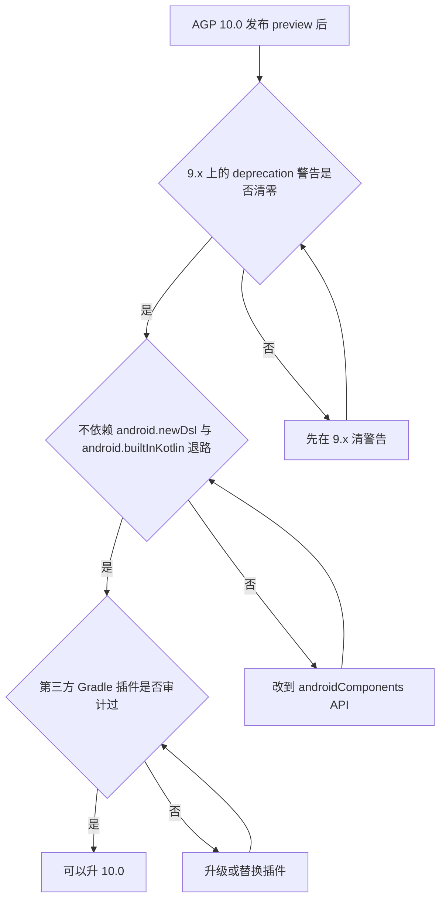

# 仓库现状对照 9.1 到 9.6 与 10.0 的逐条判定

> **状态**: **frozen**. 写下的结论不改; 后来的更正留在原处.
> 各版本特性在 [01](01-agp-9-1-to-9-6.md) 与 [02](02-agp-compatibility-kgp.md),  
> AGP 10.0 在 [03](03-agp-10-0.md).

判定日: 2026-11-04. 仓库侧的证据是当场核过的 (文件路径加行号);  
官方要求的数字抄自 [01](01-agp-9-1-to-9-6.md) 到 [03](03-agp-10-0.md), 属转述未核.

按 [09-构建约定](../../../agents-cn/09-构建约定.md) 的禁令, 本篇不复述仓库自己的版本号,  
只点名真值源文件或 key; 外面世界的版本号照留在句子里.

## 仓库的真值源

| 值 | 真值源 |
|---|---|
| AGP (stable, beta, canary) | `gradle/toml/android.toml` 的 `androidGradlePlugin`, `androidGradlePlugin-beta`, `androidGradlePlugin-canary` |
| KGP | `gradle/toml/kotlin.toml` 的 `kotlin`; 抬升机制在根 `build.gradle.kts` 的 `buildscript` 块 |
| SDK, build-tools, NDK, CMake, 代码用 JDK | `gradle/toml/build.toml` 各 key |
| Gradle | `gradle/wrapper/gradle-wrapper.properties` 的 `distributionUrl` |
| daemon 用 JDK | `gradle/gradle-daemon-jvm.properties` 的 `toolchainVersion` 与 `toolchainVendor` |
| 构建开关 | `gradle.properties` |

## 对照判定表

| 检查项 | 官方要求 (9.x 全线) | 仓库真值源 | 判定 |
|---|---|---|---|
| AGP 版本 | 9.5 是调查日的最新稳定线 | `android.toml` 的 `androidGradlePlugin` | 该 key 指向的值就是 9.5 线, 正在最新稳定版上; `androidGradlePlugin-canary` 已指向 9.6 的 alpha 线 |
| Gradle | 9.6 要求最低 9.7.1, 是 9.x 全线最高要求 | `gradle-wrapper.properties` 的 `distributionUrl` | wrapper 指向的 Gradle 版本高于 9.7.1, 满足 9.1 到 9.6 全线 |
| daemon 用 JDK | 全线最低 17 | `gradle-daemon-jvm.properties` 的 `toolchainVersion` | 高于最低值 |
| 代码用 JDK | 全线最低 17 | `build.toml` 的 `javaToolchain` | 高于最低值 |
| KGP | AGP 9.0 运行时依赖最低 2.2.10; 9.2 内置依赖 2.3.10 | `kotlin.toml` 的 `kotlin` 加根 `build.gradle.kts` 的 `buildscript` 块 | 高于 9.x 全线要求, 且官方认可的 buildscript 抬升机制已在用 |
| compileSdk | 官方兼容表最高记录 API 37.0, 要求 AGP 9.1.1 起 | `build.toml` 的 `compileSdk` 与 `compileSdkMinor` | 仓库取 37.2, 官方兼容表没有 37.1 或 37.2 的行; 构建实际走得通, 属官方文档未覆盖区 |
| Build Tools, NDK, CMake | 官方默认 Build Tools 36.0.0, NDK 默认 r28c | `build.toml` 的 `buildTools`, `ndk`, `cmake` | 仓库钉值高于默认, 且按 09 约定与 CI 同步, 满足 |
| 动态 feature 校验 (9.4) | 有动态 feature 的项目要检查 flavor dimension 对齐 | 仓库构建文件里没有 `dynamicFeatures` | 不受影响 |
| R8 重打包 (9.1) | 靠包名反射或 ServiceLoader 的场景受影响 | 反射调用点见下面的证据 | 全部反射目标是框架类, 无对自身类的反射, 无 ServiceLoader, 未识别到影响 |
| R8 keepattributes (9.2) | 通配符不再匹配三个运行时不可见注解类 | `app/proguard-firebase-rules.pro` 第 4 行显式写全名 `SourceFile,LineNumberTable` | 不受影响 |
| 设备端覆盖率 (9.6, 实验性) | 可选项, 需要显式开 flag | `gradle.properties` 未设相关 flag | 未启用, 不涉及 |
| 备份恢复测试 (9.5, 实验性) | 可选项, 需要显式开 flag | `gradle.properties` 未设相关 flag | 未启用, 不涉及 |

## 逐条证据 (当场核过)

- AGP 取值: [android.toml](../../../../gradle/toml/android.toml) 第 7 到 9 行,  
  `androidGradlePlugin`, `androidGradlePlugin-beta`, `androidGradlePlugin-canary` 三个 key.
- KGP 取值与抬升机制: [kotlin.toml](../../../../gradle/toml/kotlin.toml) 第 3 行的 `kotlin`;  
  [build.gradle.kts](../../../../build.gradle.kts) 第 14 到 18 行的 `buildscript` 块,  
  注释点名 AGP 9.0 的 KGP 运行时依赖升级.
- 构建栈取值: [build.toml](../../../../gradle/toml/build.toml) 的  
  `minSdk`, `compileSdk`, `compileSdkMinor`, `compileSdkExtension`, `targetSdk`,  
  `buildTools`, `ndk`, `cmake`, `javaToolchain`.
- Gradle 取值: [gradle-wrapper.properties](../../../../gradle/wrapper/gradle-wrapper.properties)  
  的 `distributionUrl` 与 `distributionSha256Sum`.
- daemon JDK 取值: [gradle-daemon-jvm.properties](../../../../gradle/gradle-daemon-jvm.properties)  
  的 `toolchainVersion` 与 `toolchainVendor`.
- 退路旗标: [gradle.properties](../../../../gradle.properties) 全文没有  
  `android.newDsl`, `android.newDsl.optOut`, `android.builtInKotlin`;  
  全仓库 grep 这三个词也无命中.
- 内置 Kotlin: 全仓库 grep `org.jetbrains.kotlin.android` 与 `kotlin-android` 无命中;  
  根 `build.gradle.kts` 的 plugins 块只挂 application, library, compose, serialization,  
  google-services, crashlytics. 仓库已在内置 Kotlin 上.
- 新 DSL: [KotlinAndroid.kt](../../../../build-logic/convention/src/main/kotlin/net/imknown/android/forefrontinfo/android/KotlinAndroid.kt)  
  第 3 到 4 行 import 的是 `com.android.build.api.dsl` 的 `ApplicationBaseFlavor` 与  
  `CommonExtension`; [AndroidApplicationConventionPlugin.kt](../../../../build-logic/convention/src/main/kotlin/net/imknown/android/forefrontinfo/android/app/AndroidApplicationConventionPlugin.kt)  
  第 31 行 configure 的是 `ApplicationExtension`. 全仓库 grep 旧 DSL 符号  
  (`BaseExtension`, `applicationVariants`, `variantFilter`, `Transform`, `deviceProvider`,  
  `testServer`, `sdkDirectory`, `ndkDirectory`, `bootClasspath`, `adbExecutable`,  
  `registerJavaGeneratingTask`, `registerResGeneratingTask`, `getCompileClasspath`)  
  在 `.kts` 与 build-logic 的 `.kt` 里均无命中.
- 唯一的 10.0 移除清单命中: [AndroidApplicationConventionPlugin.kt](../../../../build-logic/convention/src/main/kotlin/net/imknown/android/forefrontinfo/android/app/AndroidApplicationConventionPlugin.kt)  
  第 44 行, `defaultConfig` 块里急切写入的 `buildConfigField("String", "GIT_BRANCH", ...)`.  
  全仓库 grep `buildConfigField` 与 `resValue` 只有这一处命中.
- R8 重打包的影响面: 反射调用点全表  
  ([PropertyDefault.kt](../../../../base/src/main/java/net/imknown/android/forefrontinfo/base/property/impl/PropertyDefault.kt)  
  第 8 与 11, 16 行, 目标 `android.os.SystemProperties`;  
  [HomeRepository.kt](../../../../app/src/main/java/net/imknown/android/forefrontinfo/ui/home/repository/HomeRepository.kt)  
  第 1073 到 1082 行, 目标 `android.webkit.WebViewUpdateService` 与  
  `android.webkit.WebViewProviderInfo`;  
  [SettingsDataSource.kt](../../../../app/src/main/java/net/imknown/android/forefrontinfo/ui/prop/datasource/SettingsDataSource.kt)  
  第 23 行, 目标是 androidx 的 Settings 类),  
  没有一处反射指向本仓库自身类; 全仓库 grep `ServiceLoader` 无命中.
- 动态 feature: 全仓库 grep `dynamicFeatures` 无命中.

## 10.0 前置条件与预演

官方给的 10.0 前置条件是: 在 9.x 上清完 deprecation 警告, 不依赖两条退路旗标, 审计第三方插件  
(roadmap 五条中的第 1 到 4 条, 抄自 [03](03-agp-10-0.md)).  
仓库已不设退路旗标, 第三方 Gradle 插件只有 Develocity, foojay resolver, Metro,  
Google Services, Crashlytics 与 KGP 一族.

官方还给了预演方法: 在 `gradle.properties` 显式设 `android.newDsl=true` 与  
`android.builtInKotlin=true` 跑一遍构建. 这是仓库升 10.0 之前唯一值得主动做的事.

升 10.0 的判定流程, 画成下面这张图:

## 判定总结

- AGP 9.1 到 9.6 (闭区间): 仓库全线满足, 9.x 线内没有任何待迁移项.
- AGP 10.0: 截至判定日没有构建产物, 无从实际验证; 静态对照 roadmap 移除清单,  
  仓库只有一个明确的迁移点, 即上面那处急切 `buildConfigField()` 换成惰性  
  `MapProperty`; 其余项 (新 DSL, 内置 Kotlin, 无退路旗标) 已就位.
