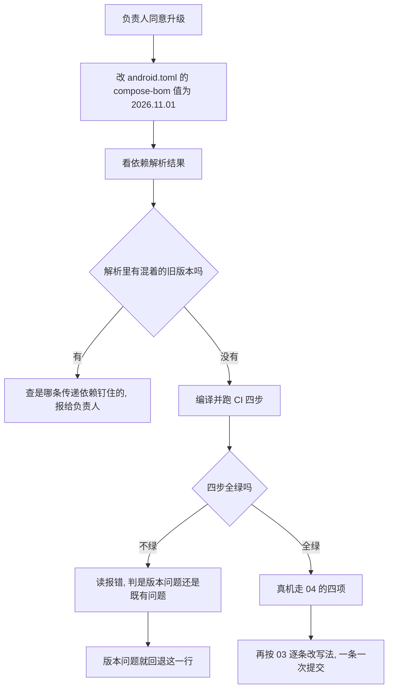

# 06 升级步骤与验收

> **状态**: **frozen**. 记下调查时 (2026-11-20) 认为走得通的顺序. 这是建议, 不是规定.

## 顺序

先只抬版本, 一条代码都不改, 跑通了再谈写法. 理由很简单: 抬版本和改写法混在一次改动里, 编译红的时候分不清是谁的错.

## 第一步: 抬版本

改 `gradle/toml/android.toml:22` 的 `compose-bom` 值. 只改这一处, 别顺手带别的.

改完看解析结果, 目标是确认 `ui`, `foundation`, `runtime`, `animation` 都落在 1.13.0, `material3` 落在 1.5.0.  
理由在 01 里写过: `material3` 自己的 pom 钉的是 1.12.0, 光看版本目录看不出实际解析到哪个.

## 第二步: 编译与检查

照 `docs/agents-cn/11-构建与验证.md` 的顺序走: 自审, 然后 `analyze-file`, Kotlin LSP, Gradle 三档.  
四条 CI 任务是验收的硬指标, 在 `docs/agents-cn/09-构建约定.md` 的 CI 一节里: `assembleFossDebug`,  
`testFossDebugUnitTest`, `:base:testDebugUnitTest`, `lintFossDebug`.

`lintFossDebug` 这一步要留意新出的弃用警告, 尤其是 `ListItem` 那三处. 警告不会让这一步变红,  
但数量突然变多说明有该迁的地方.

## 第三步: 真机四项

照 04 的表走. 四项里前两项是听和看, 第三项是截图比对, 第四项要滑到长列表底部.

## 怎么算做完

- 四条 CI 任务全绿.
- 真机四项都过, 或者没过的项已经写清为什么不影响发布.
- 用户能看到的差别只有这几种里的某几种: 点击音 (保留的话), 文字行高 (差在看不出来也算过),  
  滚动条观感 (换了官方实现才有), 设置页行高 (迁了 `ListItem` 才有).
- 代码里不留到期没处理的注释: `ui/AppRoot.kt:142` 那句 "still an experimental API in m3 1.4.0",  
  `ui/common/ScrollBarExt.kt:30-33` 那句 "官方还没提供".

## 回退

版本和写法要能分开回:

- 抬版本出问题: 把 `gradle/toml/android.toml:22` 改回原值, 一行的事.
- 某一处写法出问题: 那一处单独一次提交, 单独回退, 不牵连别的.

核实程度: 步骤与判定是本篇按仓库现有规则 (09, 11, 12) 排的; 上游版本的数字转述未核 (出处: 01 里那条 BOM 映射,  
以及各库 1.13.0 发行说明).
