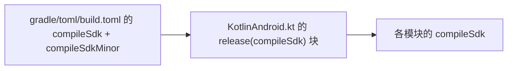

# 01-升级门槛与Gradle配置

> **状态**: **frozen**. 记下写下时查到的现状与结论.

Compose 2026.11.01 BOM 把核心模块升到 1.13.0, Material3 升到 1.5.0.  
官方博客给出的升级要求: Kotlin 2.2 以上, compileSdk 37.1 以上.  
本节核对这几个门槛与本项目构建配置的对应关系.  
(转述未核: 官方博客 jetpack-compose-november-2026-release 与官方 bom-mapping 页面)

## 门槛核对表

| 门槛 | 上游要求 | 本项目的真值源 | 判定 |
|---|---|---|---|
| Kotlin | 2.2 以上 (compose-ui beta01 notes [I82396]) | `gradle/toml/kotlin.toml` 的 `kotlin` 条目 (第 3 行) | 该值高于要求 |
| compileSdk | 37.1 以上 (compose-ui alpha03 notes [I05b0f]) | `gradle/toml/build.toml` 的 `compileSdk` 与 `compileSdkMinor` 两个 key (第 10 与 11 行) | 高于要求, 推导见下一节 |
| AGP | 9.2 以上 (compileSdk 37.1 的配套要求) | `gradle/toml/android.toml` 的 `androidGradlePlugin` 条目 (第 7 行) | 该值高于要求 |
| lifecycle-runtime | 2.10.0 以上 (compose-ui beta01 notes [I99bfd]) | `gradle/toml/android.toml` 的 `lifecycle` 条目 (第 36 行) | 该值高于要求 |

(上游要求栏转述未核: compose-ui release notes 对应的 alpha03 与 beta01 段落;  
真值源栏当场核过: 各文件行号)

按 09-构建约定的 "正文里不写版本号", 本节不复述本项目构建文件里的值;  
要核对数值, 打开上表点名的文件看对应的 key.

## compileSdk 的推导链

`isPreview` 为 `false` 时, `build-logic` 不走 preview 分支:

当场核过: `build-logic/convention/src/main/kotlin/net/imknown/android/forefrontinfo/android/KotlinAndroid.kt`  
第 32 到 40 行. `isPreview` 为假时读 `compileSdk` 与 `compileSdkMinor` 两个 key,  
在 `release(compileSdk)` 块里设 `minorApiLevel`, 组出的 compileSdk 高于 37.1 的要求.

## BOM 的管辖面

- `gradle/toml/android.toml` 的 `compose` bundle (第 112 行) 列的 artifact 全部由 BOM 定版:  
  `compose-ui`, `compose-ui-graphics`, `compose-ui-tooling`, `compose-ui-tooling-preview`,  
  `compose-material3`. 这些条目都不带 `version.ref`. (当场核过: 第 75 到 79 行)
- BOM 之外的 Compose 相邻依赖各有独立版本线, 这次升级不碰它们: `activity-compose` 用  
  `activity` 条目, navigation3 用 `navigation` 条目, lifecycle 系用 `lifecycle` 条目.  
  (当场核过: android.toml 第 81 到 91 行)
- 升级动作只有一个: 改 `gradle/toml/android.toml` 的 `compose-bom` 条目 (第 22 行) 到 2026.11.01.

## 版本分级

1.13.0 与 Material3 1.5.0 都是 Stable, 发布日期 2026-11-18.  
按 09-构建约定的版本分级, Stable 版本可以直接进生产,  
不需要 Beta/Alpha 档位的 "充分研究已知问题" 前提.  
(转述未核: 各 release notes 页面顶部的版本表)

## 升级失败的退路

构建或运行出问题时, 把 `compose-bom` 条目改回原值即可回退.  
该条目是这次升级唯一要动的构建文件.
