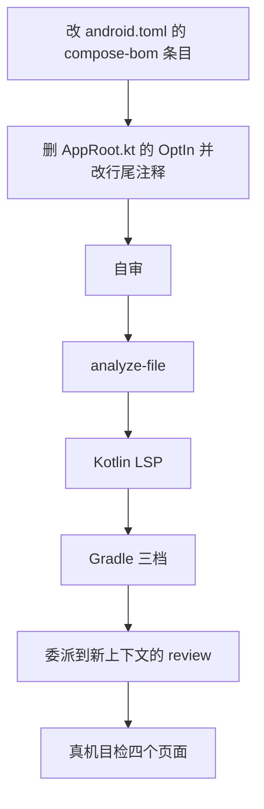

# 04-待负责人决定的事

> **状态**: **frozen**. 记下写下时摆开的决定.

按 02-工作原则的决定逐条摆开: 下面三件事各摆各的, 每条列走得通的做法与各自的好处代价,  
负责人挑.

## 第 1 条: 升不升 BOM

- 做法 A: 升. 改 `gradle/toml/android.toml` 的 `compose-bom` 条目到 2026.11.01.  
  好处: 拿到 1.13 的全部修复 (含若干崩溃类 bug fix) 与性能优化, 解锁 03 节的新 API.  
  代价: 引入 03 节的行为变化, 需要一次真机目检; 回退只改回该条目一个值.  
  失败时怎么办: 构建或 UI 出问题就把该条目改回原值, 再单独排查,  
  不缩小检查范围 (09-构建约定).
- 做法 B: 暂不升, `compose-bom` 条目保持原值.  
  好处: 零风险.  
  代价: 1.13 的修复与新 API 全部拿不到, 下次升级跨度更大; `AppRoot.kt` 的过时注释继续留着.
- 推荐 A: 门槛全满足 (01 节), 源码影响接近零 (02 节), 上游为 Stable (01 节版本分级).

## 第 2 条: 删不删 AppRoot.kt 的 OptIn

- 做法 A: 跟第 1 条一起删 `@OptIn(ExperimentalMaterial3Api::class)` 并改行尾注释.  
  好处: 清掉升级后必然过时的注解与注释.  
  代价: 无独立代价, 但不升级时做不了 (m3 1.4 时代 `TopAppBar` 仍是实验 API, 提前删会编译失败).  
  失败时怎么办: 若转正范围与 release notes 不符导致编译报错, 恢复该 OptIn 即可.
- 做法 B: 不删. 好处: 少一处改动. 代价: 留着过时的实验注解与注释.
- 推荐 A, 且只在第 1 条选 A 时执行.

## 第 3 条: compose-lint-checks 跟不跟着升

- 做法 A: 升级 Compose 时先查上游 release notes, 有适配 1.13 的新规则就升  
  (`gradle/toml/thirdParty.toml` 的 `composeLintChecks` 条目).  
  好处: lint 规则覆盖新 API 的反模式.  
  代价: 多一次第三方升级的回归面.  
  失败时怎么办: lint 报错先判是新规则抓的真问题还是误报, 误报就把该条目改回原值.
- 做法 B: 这次不动. 好处: 第三方依赖不进本次改动.  
  代价: 新 API 的反模式检查缺失, 差距留给下次升级.
- 推荐先按做法 A 查上游, 查完再定升不升: 查询动作本身不引入风险.

## 执行路径 (第 1 条选 A 时)

按 02-工作原则的验证顺序, 先自审再依次往下:

Gradle 三档的具体任务与 CI 的对应关系见 11-构建与验证与 09-构建约定.  
末尾的真机目检是 03 节行为变化要求的额外一步, 不属于 02-工作原则那条固定顺序.
