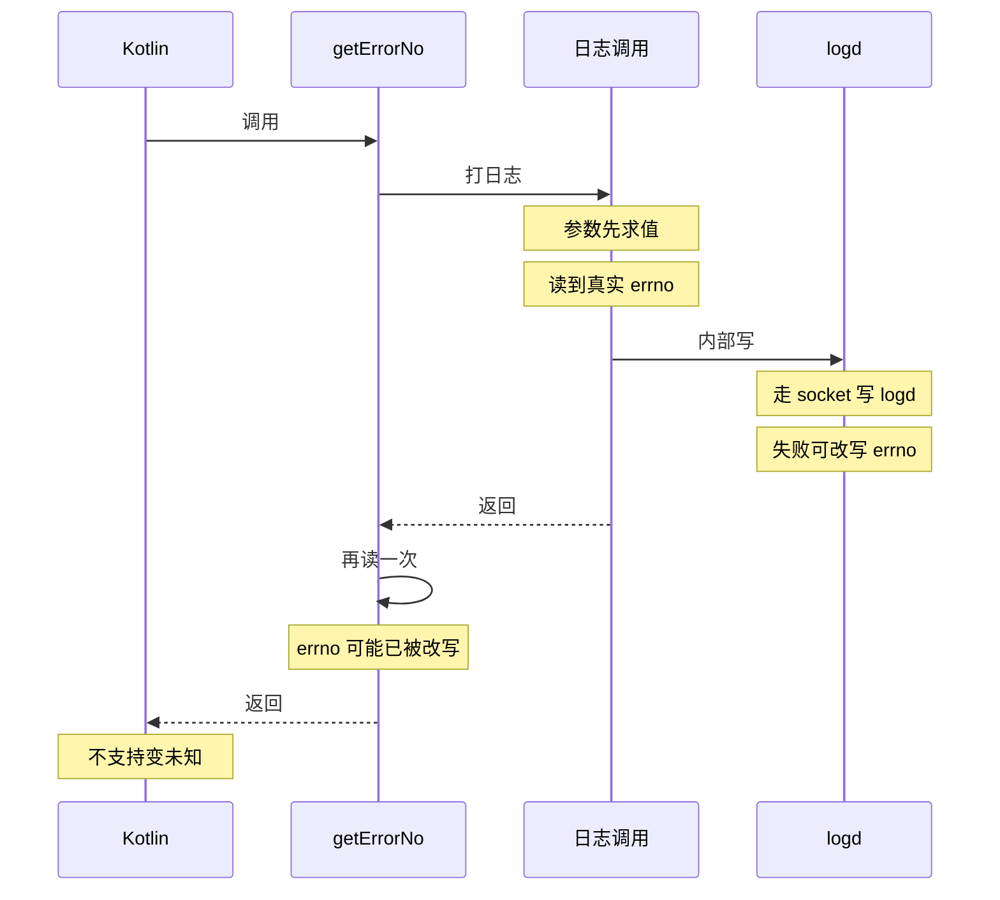

# 25 errno 在日志调用之后才读取

> 返回 [README 索引](../README.md) · [5 · 稳定性与错误处理](../README.md#5--稳定性与错误处理).

**严重程度: P2 | 修复难度: 低**

**结论**: `binderDetector/src/main/cpp/BinderDetector.cpp` 的 `getErrorNo()` 顺序是先  
`__android_log_print(ANDROID_LOG_WARN, "BinderDetector", "... errorNo: %d, error: %s", function, driverChars, ret, errno, strerror(errno))`,  
再 `int errorNo = -abs(errno)`: 返回给 Kotlin 的那个值取的是 **打完日志之后** 的 `errno`.  
参数里的 `errno` 与 `strerror(errno)` 在调用前求值, 读到的还是真实失败原因;  
问题出在后一次: `__android_log_print` 内部要走 socket 写 logd,  
这次调用自身失败或其内部的 libc 调用都可以改写 `errno`.

是否真被改写取决于运行期 (该条日志有没有被过滤掉, logd 写入有没有失败), 所以这是概率性的失真, 不是每次都错.

**证据**: Kotlin 侧完全靠这个返回值分档:  
`OthersRepository.getBinderStatus()` 把 `-ArchitectureDataSource.ERRNO_NO_SUCH_FILE_OR_DIRECTORY`  
(= -2, ENOENT) 显示为 `R.string.result_not_supported`,  
把 `-ERRNO_PERMISSION_DENIED` (= -13, EACCES) 显示为 unknown, 其余落 `else` 也是 unknown. `errno` 一旦被覆盖,  
本该 "不支持" 的结果就变 "未知", 反之亦然.

下面这张时序图画 `getErrorNo()` 里 `__android_log_print` 与取返回值的先后:  
参数求值读到真实 `errno`, 打完日志后的那次读取可能拿到被改写的值:

**修复方向**: 系统调用失败后 **立刻** 把 `errno` 存进局部变量,  
再用该变量打日志与返回 (`int errorNo = -abs(errno);` 上移到 `__android_log_print` 之前),  
这是 `errno` 使用的通例.
