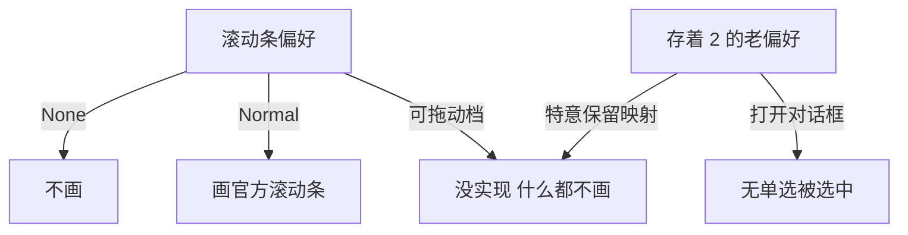

# 37 滚动条 "可拖动" 模式是 stub

> 返回 [README 索引](../README.md) · [7 · UI 与无障碍](../README.md#7--ui-与无障碍).

**严重程度: P2(🟢) | 修复难度: 低**

- **数组维持现状**: `ui/settings/res/values/arrays.xml` 的 `scrollBarKeys` 三个 item 里第三个  
  (`@string/interface_fast_scroll_bar_key`) 是注释状态, `scrollBarValues` 侧对应的  
  `@string/interface_fast_scroll_bar_value` item 同样注释, 两侧改成一致的 2 项  
  (曾经的 2/3 错位以 values 侧为准修成一致, 见 [archived #18](../archived/05-稳定性与错误处理/18-滚动条数组错位.md));  
  默认值是 None, `SettingsStore` 初始化时拿  
  `interface_no_scroll_bar_value` 作默认值.
- **两档今天生效**: 这个偏好经 `SettingsStore.scrollBarMode: StateFlow` 送出 (根部经 `LocalScrollBarMode` provide; 曾经的  
  `MyApplication.scrollBarMode` 伴生流由 `121dd849` 引入, 已迁入 store,  
  原条目见 [archived #08](../archived/02-SSOT-唯一数据来源/08-设置无唯一数据来源.md)), 两个滚动列表  
  (`ui/base/list/MyModelListScreen.kt` 的 `MyModelListContent()` 与  
  `ui/settings/SettingsScreen.kt` 的 `SettingsContent()`)  
  各自在 `scrollBarMode.drawsScrollBar` 为真且 `listState.scrollIndicatorState` 非空时挂 material3 官方的  
  `Modifier.nonInteractiveScrollbar(indicatorState, Orientation.Vertical)`. 所以 None 与 Normal 都是接了线的:  
  设置改了立即反映在页面上, 不需要重进页面.
- **stub 只在第三档**: `ScrollBarMode.drawsScrollBar` 只对 `Normal` 为 true (`base/MyApplication.kt`),  
  `Draggable` 没有任何实现, 选它等于选 "什么都不画".
- **官方组件已到位并接入**: material3 官方的 `Modifier.nonInteractiveScrollbar(state, orientation)`  
  (material3 1.5.0 sources 的 Scrollbar.kt) 已接到两个列表上, 自绘替身 `ui/common/ScrollBarExt.kt` 已删除;  
  调用点只传 `listState.scrollIndicatorState` 与 `Orientation.Vertical`, 厚度, 颜色, 淡出参数全部取官方默认值.
- **官方组件不解决 "可拖动"**: 官方扩展按其名字就是非交互的 (`nonInteractiveScrollbar`),  
  所以官方组件到位并不等于 `Draggable` 有了实现, fast-scroll 若还想要是另一件事.
- **历史载体**: 原 `ui/common/ViewExt.kt` (只切 `RecyclerView.isVerticalScrollBarEnabled`) 已随 `64e36091` 删除.  
  `base/MyApplication.kt` 的 `ScrollBarMode` 注释记录了更早的一段: 那一档对应 View 时代的 fast scroll,  
  其 RecyclerView `FastScroller` 早在 2019 年就因 bug 被弃用.
- **界面选不到第三档**: `SettingsChoiceDialog()` 用 `labels.zip(values)` 配对, 数组两侧各 2 个活 item,  
  所以对话框里只渲染 2 个选项.  
  存着 `"2"` 的老偏好仍会被读成 `Draggable`, 因为  
  `SettingsStore.parseScrollBarMode()` 特意保留那条映射 (`interface_fast_scroll_bar_value -> ScrollBarMode.Draggable`),  
  正是为了认得这个值而不是把它压成 None;  
  枚举也因此保持三档而不折成一个布尔位. 这类老用户打开对话框还有一个观感后果: 两个选项的 value 都不等于 `"2"`,  
  没有任何单选被选中.

下面这张图画 `ScrollBarMode` 三档今天的生效情况, 以及存着 "2" 的老偏好经 `parseScrollBarMode()` 的特殊走向:

**处理**: 官方滚动条组件已到位并接入, None 与 Normal 两档照常生效; 剩下的缺口仍是 "可拖动" 的实现,  
fast-scroll 若还想要是另一件事, 动手时机跟着它的需求走.
