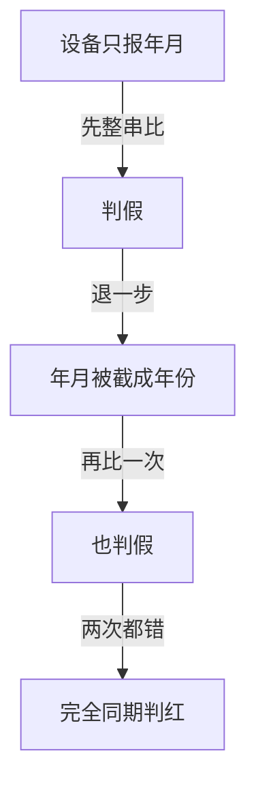

# 43 比对语义事实上存在: 逐行, ad hoc

> 返回 [README 索引](../README.md) · [8 · 反模式与卫生](../README.md#8--反模式与卫生).

**严重程度: P1(🟡) | 修复难度: 中 (特征测试锁定, 注册表实现时迁入注册表条目)**  
**影响文件: `ui/home/repository/HomeRepository.kt`, `ui/home/repository/LldComparisons.kt`**

约 12 个 Home 行对参考 json (`lld.json`) 做比对, 其比较判断曾逐行散在各函数体里,  
各写各的且无测试. 现状: 判断已逐条具名到 `ui/home/repository/LldComparisons.kt`  
并配特征测试锁定, securityPatch 的月精度错例已修, 条目留下的是注册表入表那一步;  
残留的比较手法层统一见 [#27](../05-稳定性与错误处理/27-比较解析杂项.md).

三处最明显的 ad hoc 写法, 现位置与状态:

- `isBuildIdDateHigherThanConfig()` (现于 `LldComparisons.kt`, internal 顶层函数, 原 `HomeRepository` 私有方法)  
  拿预览版偏移做魔法算术: `250205 - 250101`, 偏移加到  
  `myBuildIdDateIntOrNull` 上再和 `lldFirstBuildIdDateIntOrNull` 比. 行为未改,  
  偏移的来历注释已补 (含 [#27](../05-稳定性与错误处理/27-比较解析杂项.md) 的非真实天数警示).
- `HomeRepository.detectMainline()` 靠补后缀的字符串比较躲版本号位数问题:  
  `"$versionName-01" >= latestGooglePlaySystemUpdates`.  
  这一处还叠着**量纲错位**: 左边是包的 `versionName` (任意格式), 右边是库里的日期 (`2026-09-01`),  
  所以 `"3.1"` 这类 3-9 开头的版本字典序恒判 "已更新" 绿;  
  包查询失败时 `versionName = ""`, 恒判 "落后" 红, 而正确说法是 "无法判定".
- `detectSecurityPatch()` (现于 `LldComparisons.kt` 的 `securityPatchMatch`) 先整串字典序比  
  `mySecurityPatch >= lldSecurityPatch`, 再退一步比年月. 它**曾有一个已知错例**, 现已修复:  
  CDD 要求补丁级别为 `YYYY-MM-DD`, 但确有设备 (老/低端/不规范 ROM) 只报 `YYYY-MM`,  
  当年 `getSecurityPatchYearMonth()` 以 `substringBeforeLast('-')` 取段, 月精度串被截成年份  
  (`"2026-09"` → `"2026"`), 两次比较都错, 完全同期的设备被判红.  
  现实现归一为取前两段 (`split('-').take(2).joinToString("-")`), 月精度设备与库同月走 Lagging (琥珀),  
  修复行为由 `DetectSecurityPatchesTest` 的月精度用例锁定; 全日期路径不变.

修复前的错例记录, 图与下面的场景都是当年实现的行为 (现已不存在): 设备只报 `YYYY-MM` 时,  
两步比较怎么先后判假:

Scenario: 只报 YYYY-MM 的设备与库完全同期却被判红  
Given CDD 要求补丁级别为 YYYY-MM-DD, 该设备只报 2026-09  
And 库里补丁串为 2026-09-05, 两者完全同期  
When detectSecurityPatch 先做整串字典序比较  
Then `"2026-09"` >= `"2026-09-05"` 为假  
When 退一步比年月, getSecurityPatchYearMonth 以 substringBeforeLast('-') 取段  
Then 设备侧取出的是年份 2026, `"2026"` >= `"2026-09"` 也为假  
And 两次比较都错, 完全同期的设备被判红

测试侧: `app/src/test` 与 `base/src/test` 合计 21 个测试类, 82 个方法;  
`app/src/test/.../ui/home/repository/` 下有 16 个 `Detect*Test` 直接测 `HomeRepository` 的检测方法,  
`DateTimeExtTest` 测 `isLldDatetime()` 的格式契约, `MyModelTest` 测 `MyModel` 的 key 映射与默认值.  
两个模板 `ExampleUnitTest` 已删.

**处理**: 特征测试锁定与已知错例处置已完成 (判断具名于 `LldComparisons.kt`, 错例已修并锁  
正确行为); 本条剩下的是比较方式随条目进注册表清单, 在检测器注册表实现时做  
([#03](../01-架构与分层/03-无三态模型与注册表.md)), 届时测试断言随语义走.

前置原本不在本条: 特征测试需要测试基础设施 ([#50](../09-构建与CI/50-CI只编译不测试.md)),  
该设施已随 1b 就位, `gradle/toml/android.toml` 的 `test` bundle 现在是 JUnit Jupiter 与 platform launcher,  
MockK 也在单测 classpath 上,  
只剩 Turbine 没引 ([#06](../01-架构与分层/06-技术栈缺口.md)). 再加新测试框架,  
按 [09-构建约定](../../../agents-cn/09-构建约定.md) 的版本分级规则要由负责人评估后采纳, 不是本条能顺带决定的.
