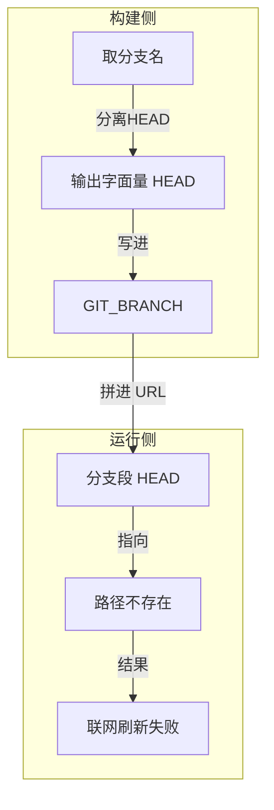

# 52 archivesName 嵌入分钟级时间戳与 git 分支名

> 返回 [README 索引](../README.md) · [9 · 构建与 CI](../README.md#9--构建与-ci).

**严重程度: P2 | 修复难度: 中**

**影响文件**:  
`build-logic/convention/src/main/kotlin/net/imknown/android/forefrontinfo/android/app/AndroidApplicationConventionPlugin.kt`,  
`app/src/main/java/net/imknown/android/forefrontinfo/ui/home/datasource/LldDataSource.kt`

**结论**: `AndroidApplicationConventionPlugin.configureName()` 在配置阶段取 `Instant.now()` (格式 `yyyyMMdd-HHmm`,  
只到分钟) 和 `git rev-parse --abbrev-ref HEAD` 的输出, 两个用途分开清洗:  
产物名的分支段把 `/` 洗成 `-` 后拼进 `archivesName.set("lld-$versionName-$versionCode-$currentDatetime-$archivesBranchName")`;  
`BuildConfig.GIT_BRANCH` 保持原始分支名, 在线 URL 的分支段语义不变.

原始分支名进产物名时, 带 `/` 的分支名 (spec 流程的 `wip/<spec 目录名>` 分支就是这样)  
会让 APK 输出文件名带上路径分隔符, AGP 在 `processFossDebugManifest` 阶段抛  
`IllegalArgumentException: File paths are not supported when setting an output file name`,  
`:app:` 的 assemble, 单测与 lint 一起红. 产物名分支段的清洗挡住这一条;  
清洗只处理 `/`, git 允许但 Windows 文件名禁掉的其余字符 (`"` `<` `>` `|`) 没洗.

**证据**:

- 每次配置都算出一个新名字 (精确到分钟): 同一份内容换不出可复用的产物标识,  
  以产物名为输入的下游 (缓存, artifact 收集) 每次都对不上;
- 值是配置阶段一次性算出的字符串, 随配置缓存一起被序列化, 命中时连旧值一起复用, 所以它不是 "当下时间";
- `providers.executeOrThrow("git", ...)` 里就是 `exec { commandLine(...) }.standardOutput.asText.get()`, 当场执行:  
  没有 git 或 `rev-parse` 非零退出时, 取值回落到字面量 `unknown` (`runCatching` 接住异常, 空输出换 `UNKNOWN`),  
  配置阶段不失败, `unknown` 照样进产物名与 `BuildConfig`, 在线 URL 的分支段变成 `unknown`;
- 分离 HEAD 时 `--abbrev-ref HEAD` 输出字面量 `HEAD`, 于是 `BuildConfig.GIT_BRANCH == "HEAD"`,  
  而 `LldDataSource.fetchOnlineLldJsonStringOrThrow()` 的在线地址是 `"https://$urlPrefixLldJson/${BuildConfig.GIT_BRANCH}/app/src/main/assets/$LLD_JSON_NAME"`  
  所以分支段变成 `HEAD`, 这个 URL 指向不存在的路径, 联网刷新 lld.json 失败.

下面这张图跨构建与运行两侧画分离 HEAD 的后果: `git rev-parse --abbrev-ref HEAD` 输出字面量 `HEAD`,  
经 `BuildConfig.GIT_BRANCH` 拼进 `LldDataSource` 的在线地址, 分支段变 `HEAD`, URL 指向不存在的路径:

**修复方向**: 产物名的时间戳交给 CI 在 artifact 命名上做, 构建内部保持稳定名; 分支相关值改由 CI 显式注入,  
在线 URL 指向稳定 ref.  
两条都得保持 configuration-cache 兼容 ([09-构建约定](../../../agents-cn/09-构建约定.md) 的约定),  
也就是不能改成运行期才读时钟或 git 的任务.

用分支名拼在线数据 URL 本身是另一件事, 有它自己的取舍, 本条不重开,  
这里只登记 `archivesName` 这一侧机械产生的后果 (缓存不命中, 取值回落 `unknown` 时 URL 段变 `unknown`,  
分离 HEAD 时 URL 段变 `HEAD`).
