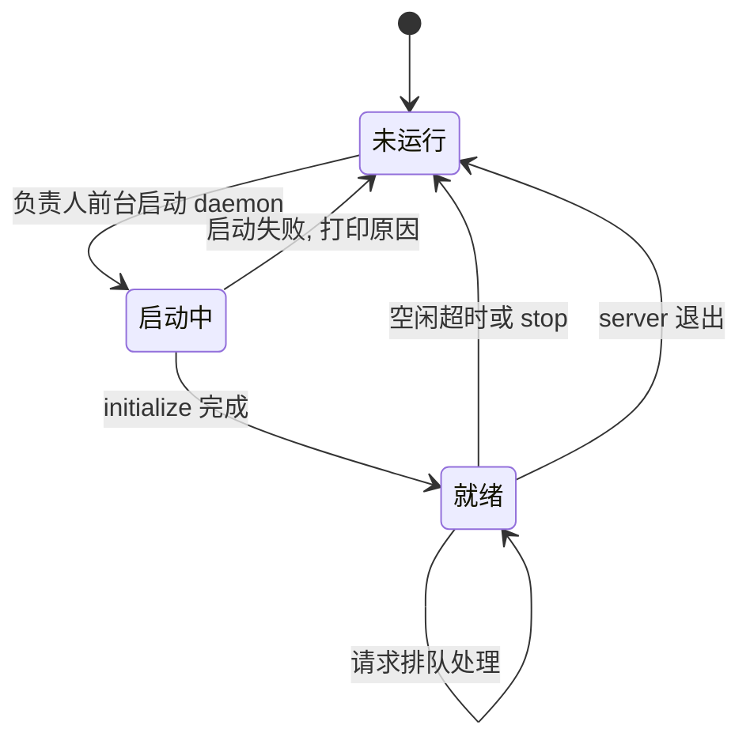

# 设计文档: kotlin-lsp-daemon

> **状态**: living. 由旧 plan.md 与 9 份 subtask 报告的方案内容重组 (2026-11-22);  
> 技术结论与负责人决定原样保留, 原文见 git 历史 `b239e621` 与 `f55afbe4`.

## 风险分级

高 (安全, 数据, 核心逻辑或生疏领域): task 2 (daemon 骨架, 生疏), task 3 (结果真实性, 生疏),  
task 6 (唯一有写盘动作的通道), task 7 (能力重探, 生疏).  
中: task 4 与 task 5 (输出回归直接影响 03 的核对义务与各调用方), task 9 (量测汇总).  
低: task 1 (新增独立模块), task 8 (文档加一个自检脚本).

## 现状前提

- 工作树已回到 HEAD. spec 之前写过的一版原型按负责人 2026-11-09 的决定全部回退, 代码与文档改动都不在;  
  `scripts/` 下三个 CLI 仍是每命令新起 server 的旧版. 每个任务都从当前 HEAD 写起, 不参照原型.
- 实测基线 (2026-11-09, 另一台 macOS 机器, 热缓存): 两次 23.4 与 23.5 秒, node 自身 CPU 只 0.31 秒.  
  固定开销构成 (现版代码可核): 每命令新起 JVM 加一次 Gradle 导入; 就绪轮询每轮先睡 5 秒  
  (`kotlin-lsp-plan.js:457`, `kotlin-lsp-edit.js:301`); ready 预算 规划 300 秒, 验证 1800 秒;  
  shutdown 10 秒加进程退出 10 秒; organize-imports 的 applyEdit 窗口 10 秒. 超时变量只是上限.  
  常驻会话下的热查询参考: 单文件诊断 0.29 秒, 规划查询 0.24 秒 (来自已回退原型, 只当目标参考).
- 10-代码分析规则 现状: `format` 与 `organize-imports` 记为停用, 脚本与干跑保留, 提交时刻这两步暂停;  
  编辑通道那条 CRLF 保证已撤回, 现在只保证越界位置钳到回车之前. 停用证据: organize imports 把显式 import  
  合并成通配符, format 把整份 CRLF 文件翻成 LF 并给零宽假编辑. 这两个专题就是本任务的 task 6 与 task 7.
- 回退时丢掉的三处文档修订, task 8 补回: 11-构建与验证 里自审与委派 review 用规划通道查引用面的义务;  
  10-代码分析规则 里对 `ILS-263.7084.0` 的注明; `scripts/kotlin-lsp-edit.js` 注释里的同一句注明.
- `ILS-263.7084.0` 字面原则: 它是发行版自带 `build.txt` 里的 build 号, server 启动时打印  
  `== Kotlin LSP ILS-263.7084.0 ==`; 字面保持原样, 注明写清它是 server 发行版自报的标签,  
  规则文件和脚本里一律叫它 Kotlin LSP; `archived/` 里的材料不回改.
- 平台: 本机是 Windows. 平台前提已真跑: 具名管道能监听, 连接, 逐行 JSON 往返并干净关闭;  
  `pathToFileURL` 与 `fileURLToPath` 对带盘符路径往返一致; 盘符不会被查询 token 从右往左切冒号切开.  
  daemon 代码还没写, 这些只是实现要用的平台前提; task 2 与 task 9 要在本机真跑实现.  
  macOS 那一侧只能代码层核对, 记成已知缺口, 不假装验过.
- 早先的双项目探针借了本仓库的索引缓存, 可能把别的项目模型写进 `workspace-model-v2.cache`;  
  起会话前按只有本仓库根的方式重做一次 warmup, 或起会话时核对没有多余根.

## 技术方案 (架构要点)

- daemon 独占唯一的 `intellij-server` 会话与索引缓存锁. 客户端只连本地端点  
  (`<indexDir>/d.sock`, Windows 用具名管道), 协议是逐行 JSON; 每次只发窄请求  
  (打开文件批次, 单个 LSP 请求), 不转发原始 LSP 流.
- 请求按 FIFO 排队, 一次只让一个批次进 server, 两个客户端同时来不互相打断.  
  锁归 daemon, 客户端不再抢锁; 锁不是提速手段, 也不删 (防多个 daemon 实例抢同一份索引缓存);  
  提速来自复用同一个 server 会话, 不再每次做 Gradle 导入.
- daemon 启动时写协议版本与代码指纹, 客户端连上先校验, 不匹配报错退出并提示重启 daemon;  
  task 3 到 task 9 的验证不许落到旧代码的服务进程上.
- 文档刷新: 客户端每次查询前发起校验, `shared.js` 存文档集与指纹, daemon 重读磁盘比对,  
  不一致就 `didClose` 再 `didOpen` 用新内容重新进模型; 比对按文件内容, 不按 git 状态, 未提交改动也算;  
  诊断拉取前等一段可配置的沉降窗口, 窗口长度与判据在验收节里按实测定.
- `workspace/applyEdit` 路由: 窄协议里带发起客户端的标识, server 发来的 applyEdit 只回给那一个客户端.
- 版本检查: 读 `<发行版>/build.txt` 拿本地 build 号, 请求 GitHub releases API 拿最新 tag, 按天缓存  
  (缓存写在索引缓存目录下); tag 来源与过期信号都可注入, 验证不发真实网络请求; 有新版本打一行提示附  
  下载链接与校验文件位置; 离线或失败静默; 检查在 daemon 就绪后异步跑, 不占冷启动关键路径.
- ready 超时变量收拢: 规划与编辑共用 `KOTLIN_LSP_PLAN_READY_TIMEOUT_MS` 默认 300000,  
  验证用 `KOTLIN_LSP_READY_TIMEOUT_MS` 默认 1800000, 两个名字与预算在同一处 (shared.js) 定清;  
  10 的编辑通道一节补自己的那条 (task 8).
- 编辑动作限定规则 (修 `--apply` 失效): 脚本内部按工作树差异自动限定, 不新增命令行开关;  
  `format` 按本次改动的行级差异裁编辑集; `organize-imports` 按本次改动的文件集合限定,  
  import 块常在差异区外, 整块留在限定范围内, 逐文件核对. 同批修 EOL 翻转与 import 合并两类失效;  
  恢复不了的形状写明原因和剩下的缺口, 不假装修好.
- 写盘验证只动临时副本: `app/src/main/java/net/imknown/android/forefrontinfo/base/ZzKotlinLspApplyProbe.kt`  
  (该目录已被 Gradle 模型覆盖); 让副本进模型靠重做 warmup 或重起 daemon, 不在会话中途触发重导入  
  (10-代码分析规则 记着重导入会把后续请求拖到超时); 验完删副本, `git status --short` 确认无多余文件,  
  再复查 workspace 根与索引缓存键仍是单根.
- 能力回归矩阵: 五列记录 (能力, 命令, 期望, 实际, 结论), 矩阵文件落本 spec 目录 (文件名实现时定);  
  五项重探各发真实请求: `format` 发 `textDocument/formatting`; organize imports 发 `codeAction` 接  
  `executeCommand` 再收 `workspace/applyEdit`; rename 发 `prepareRename` 与 `rename`, `will-rename`  
  单独发一次或写明不探及理由; quickfix 发 `codeAction` 接 `executeCommand` 收 `WorkspaceEdit`;  
  type hierarchy 发 `prepareTypeHierarchy`, 有结果再发 supertypes 与 subtypes, 回空把未发与原因记进矩阵.  
  探针要领照 10-代码分析规则: 只读不落盘, 不打开 Gradle 模型之外的新文件, rename 首次计算按 180 秒预算.  
  语义高亮, folding, code lens 按 10 维持不做, 不进矩阵.
- daemon 生命周期:

## 方案取舍 (负责人 2026-11-10 逐条挑定, 直接原因与代价)

- 自动拉起: 选只留手动前台启动 (T1 A). 直接原因: 入口唯一, 失败显式, 不在脚本里藏拉起逻辑;  
  代价是机器重启或空闲退出后要负责人重起一次.
- 失败处理: 选报错退出绝不上报 `CLEAN` (2A). 直接原因: 假 `CLEAN` 比慢更糟, 流程会拿它当通过.
- 锁: 选保留归 daemon (3B). 直接原因: 它防多实例抢索引缓存, 删了省不下时间还要改 10 的契约;  
  提速来自复用会话.
- 非提速项: 选全保留 (4A). 直接原因: 版本检查, 能力矩阵, 文档修订, ILS 注明都是负责人点名要的.
- 共享范围: 选 A, 本机所有进程可连, 只服务本仓库.
- 落选做法: 客户端自动回落到一次性模式 (改动四处才装得下, 且把失败藏起来); 多项目共用 (负责人 2026-11-09 明确不做);  
  重排 task 顺序把版本检查并入骨架 (牵动全篇编号与已过审材料, 代价大于收益, 采 "模块先单独验, 接进启动归 task 2").

## 覆盖映射

R-1 → task 9 量测; R-2 → task 4/5/6 的契约保持加基线对比; R-3 → 架构要点加生命周期 (task 2);  
R-4 → 失败路径 (task 2, 4, 5, 6, 9); R-5 → 锁与队列 (task 2); R-6 → 能力矩阵 (task 7) 加编辑恢复 (task 6);  
R-7 → 版本检查 (task 1) 加文档与自检 (task 8); R-8 → 单根核对 (task 2, task 9); R-9 → 文档刷新 (task 3).

## 待学习清单

- LSP 的 `workspace/applyEdit` 与 `executeCommand` 时序, 以及本 server 的 mod command 形状.
- IntelliJ 平台按文档差量算编辑时精确到什么程度, 与 `rename` 时好时坏的关系.
- 守护进程的优雅退出与缓存刷盘时机, 避免杀进程把索引锁写坏.
- `format` 与 `organize-imports` 的编辑怎么限定到本次改动的文件与区域, 以及 CRLF 文件怎么保住 EOL.

## 风险

- 快的前提是文档状态正确; 刷新漏了就是假结果, 比慢更糟. task 3 与 task 7 专门盯这个.
- daemon 只由负责人前台启动; 不回落之后, daemon 没起来会直接挡住验证流程,  
  task 8 的启动命令和 14-跨端 Review 的说明要能照着一次做对.
- 常驻会话改变了诊断送达的时序, quickfix 与 rename 的旧结论可能不再成立, task 7 按真实请求重判.
- `format` 与 `organize-imports` 的失效出在写盘, task 6 用临时文件验, 避免把仓库里的代码改成别的样子.
- 改动面大 (共用库加三个 CLI 加文档), 靠一笔一笔可独立验证的提交控制.
