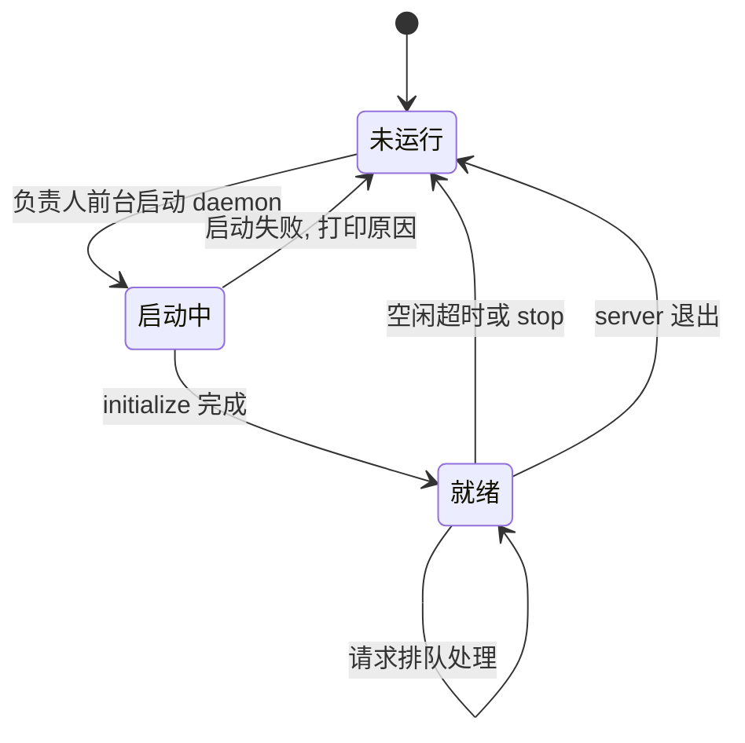

# plan: kotlin-lsp-daemon

## 负责人预写 (开工前手写, 任务结束前不改)

问题, 目前 Kotlin LSP 脚本性能太差, 所以重构  
打算: 作为 独立进程, 可以一直活着. 长时间没人使用, 再停止  
风险: 涉及 LSP 功能比较多, 可能需要大量例子和时间重新测试

## AI 计划

### 目标

核心目标: 一切为了提升性能, 减少 LSP 时间. 单次 LSP 查询从 23 秒上下的固定起步开销降到热查询 2 秒内,  
三个 CLI 的命令行与输出形状不变, 跨端 reviewer 不加配置就能用. 顺带补一项版本检查, 提醒新版本和发行版过期.  
负责人定的另一条目标: Kotlin LSP 现有能力在 daemon 化之后一项都不丢,  
停用的两项和未接的能力都在本任务里逐样重探, 写清能不能接成可写操作.  
拿不到常驻 daemon 时宁可不执行 LSP, 也不回落到一次性模式.

实测基线 (2026-11-09, 另一台 macOS 机器, 热缓存): 现版脚本两次实测是 23.4 秒与 23.5 秒,  
node 自身只占 0.31 秒 CPU. 下面这几项固定开销是现版代码可核的事实:  
时间花在每命令新起 JVM 加一次 Gradle 导入,  
就绪轮询每轮先睡 5 秒 (`kotlin-lsp-plan.js:457`, `kotlin-lsp-edit.js:301`),  
没就绪就再来一轮, 一直烧到 ready 预算 (规划 300 秒, 验证 1800 秒);  
结束时要等 shutdown 10 秒加进程退出 10 秒, organize-imports 还要等 applyEdit 10 秒.  
超时变量只是上限, 不会主动等待; 三个脚本共用一把锁, 拿不到直接失败退出, 不排队.  
常驻会话下的热查询是单文件诊断 0.29 秒, 规划查询 0.24 秒,  
这两个数字来自一版已回退的原型, 只当目标参考, 工作树里没有它的代码; 原始记录在 `progress.md`.  
本机是 Windows, 只跑过平台前提探针, 热查询 2 秒这个目标要在本机重测一次.

### 范围

- 在: `scripts/kotlin-lsp-shared.js` (新增), `scripts/kotlin-lsp-daemon.js` (新增),  
  `scripts/kotlin-lsp-plan.js`, `scripts/kotlin-lsp-diagnostics.js`, `scripts/kotlin-lsp-edit.js`,  
  `scripts/kotlin-lsp-selfcheck.js`, `docs/agents-cn/10-分析细则.md`, `docs/agents-cn/11-构建与验证.md`,  
  `docs/agents-cn/14-跨端review.md`.
- 不在: 全机多项目共用 (负责人 2026-11-09 定不做); 自动下载与安装新版本 (要负责人单独同意);  
  编辑器界面向能力.
- format 与 organize-imports 是现成的脚本化能力, 因写盘失效停用: 子任务 6 修实现并恢复,  
  子任务 7 的矩阵记录结果并回写 10 的能力盘点. 现在不预先排除恢复任何一项.
- rename, quickfix, type hierarchy 这些未接能力, 子任务 7 的矩阵判定能不能接成可写操作,  
  现在不预先排除; 本任务只交结论与所需条件, 接入实现归后续任务, 不新增子任务.
- `10-分析细则` 里点到的 format 与 organize-imports 用法专题, 就是本任务的子任务 6, 7, 8,  
  没有另外的任务. 两项停用是开工前的现状; 6 负责接入与用法设计, 7 负责重探判定并回写能力盘点,  
  8 负责其余文档核对与自检, 三者分工不重叠.

### 现状前提

工作树已经回到 HEAD. spec 之前写过的一版原型按负责人 2026-11-09 的决定全部回退, 代码与文档改动都不在了;  
`scripts/` 下的三个 CLI 仍是每命令新起 server 的旧版. 所以每个子任务都从当前 HEAD 写起, 不参照原型.

`10-分析细则` 现在把 format 与 organize-imports 记为停用, 脚本与干跑保留, 提交时刻的这两步暂停;  
编辑通道那条 CRLF 工作副本保持 CRLF 的保证已经撤回, 现在只保证越界位置钳到回车之前.  
能力盘点里 organize imports 与格式化两行都写着等专题设计, server 升级后是否重探也归专题定.  
这些话里的专题就是本任务, 子任务 6, 7, 8 认领它们.

回退时一起丢掉的文档修订在三个文件, 由子任务 8 补回: `11-构建与验证` 里自审与委派 review  
用规划通道查引用面的义务, `10-分析细则` 里对 `ILS-263.7084.0` 的注明,  
`scripts/kotlin-lsp-edit.js` 注释里的同一句注明. 子任务 8 的清单要把三个文件列全.

那次修订的形状: `11` 要求自审和委派出去的 review 用 `kotlin-lsp-plan.js` 的  
`references`, `definition`, `calls-in` 查引用面, 一次会话批量查完, 证据带 `path:line:col`,  
单个文件的诊断不在 review 里重跑; `10` 和脚本注释都注明 `ILS-263.7084.0` 是 server 发行版自报的标签,  
规则文件和脚本里一律叫它 Kotlin LSP. 措辞收窄到"规则文件和脚本里", 免得和历史写法打架.

`ILS-263.7084.0` 是发行版自带 `build.txt` 里的 build 号, `progress.md` 的版本检查记录读过这个文件;  
server 启动时打印的也是 `== Kotlin LSP ILS-263.7084.0 ==`.  
`f5b807bb` 改掉的是仓库自造的 ILS 简称, 那次提交没有碰这类字面.  
`kotlin-lsp 263.7084.0` 这个串谁都没打印过, 改了会丢追溯性, 所以字面保持原样.  
`archived/` 下的材料标成 record, 里面的 ILS 按 07 不回改.

### 架构要点

- daemon 独占唯一的 `intellij-server` 会话与索引缓存锁, 客户端只连本地 socket  
  (`<indexDir>/d.sock`, Windows 用具名管道), 协议是逐行 JSON.
- 三个客户端每次只发窄请求 (打开文件批次, 单个 LSP 请求), 不转发原始 LSP 流.
- 请求按 FIFO 排队, 一次只让一个批次进 server, 两个客户端同时来也不互相打断.
- 锁归 daemon, 客户端不再抢锁. 锁不是提速手段, 也不删: 它防多个 daemon 实例抢同一份索引缓存.  
  提速来自复用同一个 server 会话, 不再每次做 Gradle 导入.
- 客户端每次查询前按磁盘内容校验打开过的文件, 变了就重新打开, 保证 reviewer 看到的是工作树当下内容.
- 空闲超时 (默认 20 分钟) 优雅退出, 另给 `status` 与 `stop`.
- 没有一次性模式, 也没有客户端自动拉起. daemon 只由负责人前台启动一次; 客户端连不上时报错退出.
- daemon 启动时写协议版本与代码指纹, 客户端连上先校验; 不匹配就报错退出并提示重启 daemon.  
  子任务 3 到 9 的验证不许落到旧代码的服务进程上.

生命周期:

### 已知限制

- 本会话的 shell 沙箱在命令结束时清掉后台进程, 脱离终端的 daemon 跨命令活不下来.  
  所以 daemon 只由负责人在不随命令结束的终端里用 `serve` 前台启动一次, 客户端不自动拉起.  
  子任务 8 要交一条能直接复制的启动命令, 它是唯一入口.
- 客户端连不上 daemon 时报错退出 (非 0), 打印明确原因和那条启动命令; 这次没跑 LSP 要写进报告,  
  绝不能退 0 让流程读成假 `CLEAN`. `10-分析细则` 的义务正文不动, 只在常驻会话一节补这一情形.
- 同一个 JVM 只用 `JAVA_HOME` 指的那个 JDK 做 Gradle 同步, 与 [10-分析细则](../../agents-cn/10-分析细则.md) 记的前提一致.
- server 这一版对 `type hierarchy` 的探针结论在原型里就不通, 子任务 7 仍要真发请求留一条记录.  
  `rename`, `quickfix`, `format`, `organize-imports` 的现状也都要在子任务 7 里重探, 旧结论只当对照.
- 原型里常驻会话能喂真实诊断, `codeAction` 回过 4 条诊断对应的 4 个动作.  
  quickfix 与 rename 在 daemon 下的结论可能变, 以子任务 7 的记录为准.
- format 的 `--apply` 实测把整份 CRLF 文件翻成 LF, organize-imports 实测把显式 import 合并成通配符.  
  子任务 6 的写盘验证用临时文件, 不套用到仓库里的代码.
- 本机是 Windows. 已在本机真跑过平台前提: 具名管道能监听, 连接, 逐行 JSON 往返并干净关闭;  
  `pathToFileURL` 与 `fileURLToPath` 对带盘符的路径往返一致, Windows 盘符不会被 token 从右往左切冒号切开.  
  daemon 代码还没写, 这些只是实现要用的平台前提, 不等于实现分支已经验过; 子任务 2 和 9 要在本机真跑实现.
- 现在只能代码层核对的是 macOS 那一侧的分支 (原先那台机器是 macOS), 记成已知缺口, 不假装验过.

### 子任务

每个子任务都要能独立验证, 独立提交. 括号里是风险级别与是否生疏领域.

1. **版本检查** (低风险, 非生疏).  
   读 `<发行版>/build.txt` 拿本地 build 号, 请求 GitHub releases API 拿最新 tag, 结果按天一缓存.  
   每启动一次只检查一遍, 三个客户端不各跑一份; daemon 空闲退出后, 下一次启动再查.  
   检查在 daemon 就绪后异步跑, 不占冷启动关键路径, 不拦住 initialize 与第一批查询.  
   有新版本打一行提示, 附对应平台的下载链接与校验文件位置; 不下载, 不安装.  
   离线或请求失败时静默, 不拦住任何查询. 已装版本比最新版旧两代以上时, 额外提示可能要换索引缓存.  
   发行版过期 (`This build of kotlin-server has expired`, 退出码 7) 由 daemon 启动失败时判定并打印,  
   不依赖版本检查的 GitHub 请求; 给一个可注入的假 build 号或退出码来验这条分支, 不要求真装一份过期发行版.  
   独立一步的理由: 检查逻辑是独立模块, 可以先单独写好并单独验; 接进启动流程归子任务 2.  
   判据: 断网, 有新版本, 已是最新, 三种情况各跑一次, 查询结果不受影响;  
   注入过期信号单列核对启动失败与提示, 过期提示不混进新版本提示;  
   检查异步跑, 冷启动仍在 25 秒内.
2. **共用库与 daemon 骨架** (高风险, 生疏).  
   `shared.js` 收 server 解析, 帧处理, 文档集, 客户端连接与 socket 路径; `daemon.js` 收 initialize,  
   请求队列, 状态与停止, 空闲超时, server 崩溃处理.  
   锁由 daemon 持有, 客户端不再抢锁; daemon 启动时原子拿锁防重复实例, 退出时释放.  
   `shared.js` 收拢三条通道的 ready 超时变量. 规划 (`kotlin-lsp-plan.js:127`) 与编辑 (`kotlin-lsp-edit.js:102`)  
   共用 `KOTLIN_LSP_PLAN_READY_TIMEOUT_MS` 默认 300000, 验证 (`kotlin-lsp-diagnostics.js:164`)  
   用 `KOTLIN_LSP_READY_TIMEOUT_MS` 默认 1800000; 两个名字与预算在同一处定清, 10 的编辑通道一节补自己的那条.  
   起会话前按只有本仓库根的方式重做一次 warmup, 或起会话时核对没有多余根.  
   早先的双项目探针借了本仓库的索引缓存, 可能把别的项目模型写进 `workspace-model-v2.cache`.  
   独立一步的理由: 三个 CLI 的接入都以它为准, 它本身可以先用 `status` 与一个小探针验完, 不掺 CLI 改动.  
   判据: 冷启动能起, `status` 能看到, `stop` 后 socket 与锁都干净, 没有僵尸 JVM, 空闲超时能自己退;  
   陈旧的 socket 与陈旧的锁能自动接管; Unix socket 权限收紧到 0600; daemon 日志按启动截断, 不无限增长;  
   workspace 里只有本仓库一个根; Windows 具名管道在本机真跑监听, 连接, 逐行 JSON 往返, 关闭;  
   用 `status` 探针验连不上 daemon 时报错退出 (非 0), 打印启动命令, 不回落, 不上报 `CLEAN`;  
   协议版本与代码指纹不匹配时客户端报错退出并提示重启; 客户端不自动拉起 daemon, 只连已有 socket.
3. **文档刷新与诊断新鲜度** (高风险, 生疏).  
   打开过文件后按磁盘内容比对, 变了就关闭重开; 诊断拉取前等到沉降窗口过去.  
   独立一步的理由: 这是"结果对不对"的唯一关口, 与"快不快"分开验, 出问题好定位.  
   判据: 改文件, 回滚, 再改, 三种情况下诊断都与磁盘一致, 未提交改动也算;  
   这一步用 daemon 侧的文档刷新探针验, 不经过三个 CLI (它们到子任务 4, 5, 6 才接入).
4. **plan.js 接入** (中风险).  
   命令, 查询串, 输出行, 退出码全部保持不变; 一次会话批量查完.  
   接入前把旧版在同一批查询上的输出存成基线文件, 放进这个 spec 目录.  
   判据: 改完的输出与那份基线逐行对比, 除 server 版本行外一致.
5. **diagnostics.js 接入** (中风险).  
   输出与退出码不变; 多次单文件调用都走同一个 daemon, 不新增多文件入参, 命令行不变.  
   接入前把旧版在同一批文件上的输出存成基线文件, 放进这个 spec 目录.  
   判据: 干净文件回 `CLEAN`, 带错误文件退出 1, 与那份基线逐行对比一致.
6. **edit.js 接入与编辑动作的用法设计** (高风险).  
   `format` 与 `organize-imports` 的命令行, 干跑输出形状与退出码保持不变;  
   `--apply` 写进文件的编辑集按新设计改变, 这正是本次要修的失效所在;  
   applyEdit 只回给发起命令的那个客户端.  
   给出把套用限定在本次改动的文件与区域的可核对用法, 在脚本内部按工作树差异自动限定,  
   不新增命令行开关, 三个 CLI 的命令行保持不变.  
   format 按行级差异限定; organize-imports 按本次改动的文件集合限定,  
   import 块常在差异区外, 整块留在限定范围内, 逐文件核对.  
   按 10 的停用证据修掉 EOL 与 import 合并两类失效, 让这两个动作恢复可用;  
   恢复不了的形状要写明原因和剩下的缺口.  
   写盘验证用临时 `.kt` 副本: 放在仓库内已被 Gradle 模型覆盖的源码目录下,  
   验前确认新副本已被 Gradle 模型纳入, 验完删除并复查 workspace 根与索引缓存;  
   进模型靠重做 warmup 或重起 daemon, 不在会话中途触发重导入,  
   `10-分析细则:262-264` 的探针要领只管只读与预算, 不教这一步;  
   具体路径与清理步骤写进子任务 6 的修改计划报告.  
   本步不单独改 `10-分析细则` 的能力盘点, 接入与用法结论交给子任务 7 的矩阵统一回写.  
   独立一步的理由: 它是唯一有写盘动作的通道, 与只读通道分开, 出事范围可控.  
   判据: 干跑不写盘; `--apply` 在临时副本上写入后逐行核对, 仓库里的代码不受影响;  
   `--apply` 之后照旧要 `git diff` 核一眼; 临时副本验完删掉, workspace 仍是单根.
7. **能力回归矩阵** (高风险, 生疏, 对应负责人提的"大量例子").  
   按 [10-分析细则](../../agents-cn/10-分析细则.md) 的能力盘点逐样跑一遍, 每样一条记录: 能力, 命令, 期望, 实际, 结论.  
   覆盖 references, definition 系, typedef, implementation, call hierarchy 双向, type hierarchy,  
   workspace/document symbols, hover, completion, signature help, inlay hints, diagnostics,  
   format, organize imports, 以及 rename 与 quickfix 的现状复查.  
   `10-分析细则:277` 的语义高亮, folding, code lens 按 10 维持不做, 不进矩阵;  
   "一项都不跳过" 管的是脚本化能力.  
   五项重探各写清发什么请求: format 发 `textDocument/formatting`,  
   organize imports 发 `codeAction` 接 `executeCommand` 再收 `workspace/applyEdit`,  
   rename 发 `prepareRename` 与 `rename`, `will-rename` 单独发一次或在矩阵里写明不探及理由;  
   quickfix 发 `codeAction` 接 `executeCommand` 收 `WorkspaceEdit`;  
   type hierarchy 发 `prepareTypeHierarchy`, 有结果再发 supertypes 与 subtypes,  
   回空就把后续两种请求未发和原因记进矩阵, 不留空行.  
   探针照 [10-分析细则](../../agents-cn/10-分析细则.md) 的 `能力盘点` 一节: 只读不落盘,  
   会话里不打开 Gradle 模型之外的新文件, rename 首次计算按 180 秒预算.  
   矩阵在这个 spec 目录, 结论回写 10 的能力盘点, 停用与未接的条目按结果改判.  
   判定某个未接能力可接时, 只写清所需条件, 接入实现归后续任务.  
   独立一步的理由: 它是验证而不是实现, 单独一轮跑完才好判断哪个能力是这次改坏的, 哪个本来就不通.  
   判据: 能力盘点的每个脚本化行各有一条记录, 五项重探各有真实请求与应答,  
   每条写明能不能接成可写操作与所需条件; 编辑器界面向那行按 10 维持不做;  
   结论回写 10 之后, 盘点里没有过期或互相矛盾的行.
8. **文档与自检** (低风险).  
   10 补常驻会话一节 (启动方式, 环境变量, 版本检查, 锁归 daemon, 连不上 daemon 时的行为),  
   改掉 `10-分析细则:229-230` 那句"三个脚本不能同时跑", 写成锁归 daemon, 客户端按 FIFO 排队;  
   编辑通道一节补自己的 ready 超时变量; 核对子任务 7 回写的能力盘点与矩阵结论一致,  
   有过期或互相矛盾的行当场修正;  
   并写一条能直接复制的 daemon 启动命令, 注明它是唯一入口;  
   同一节写明何时关闭: 空闲 20 分钟自动退出, `stop` 立刻释放, `status` 查状态,  
   改过 `shared.js` 或 `daemon.js` 后指纹不匹配要先 `stop` 再起;  
   补回回退时丢掉的文档修订, 三个文件都列全: 11 里自审与委派 review 用规划通道查引用面的义务;  
   10 里对 `ILS-263.7084.0` 的注明; `scripts/kotlin-lsp-edit.js` 注释里的同一句注明.  
   注明写清字面是 server 发行版自报的标签, 规则文件和脚本里一律叫它 Kotlin LSP, 字面不改;  
   `10-分析细则:36` 与 `:59` 的单文件诊断规则改成批量一次; 11 不写诊断规则.  
   14 补跨端 reviewer 怎么用这个通道, 指向 10 里的那条启动命令;  
   `kotlin-lsp-selfcheck.js` 改成走 daemon, 仍能分清"没有工程模型"和"代码干净".  
   判据: 自检在好缓存与坏缓存上各跑一次, 结论不同;  
   按清单逐项核对文档交付, 每项都能 grep 到: 可复制的启动命令与唯一入口,  
   空闲退出与 `stop` 与 `status` 与指纹重启, 10 的常驻会话一节与 229-230 的新句子,  
   10 的批量诊断规则, 14 的指向, ILS 注明与脚本注释.
9. **全量验证** (中风险).  
   热查询耗时达标 (单文件诊断与规划查询各 2 秒内, 冷启动 25 秒内);  
   两个客户端并发; `stop` 之后无残留;  
   比对起会话前后 workspace 根列表与 `workspace-model-v2.cache` 的键, 只有本仓库一个根, 没有多余项目模型;  
   三个 CLI 连不上 daemon 时都报错退出 (非 0), 打印启动命令, 不回落, 不上报 `CLEAN`;  
   Windows 具名管道与路径分支在本机真跑一遍; macOS 那侧只能代码层核对, 记偏差;  
   三个 CLI 在一批真实改动上跑通, 再发 review.  
   独立一步的理由: 前面各步只看自己那一块, 这一步才看合起来的样子与真实改动.

### 判据汇总

- 三个 CLI 的命令行与输出形状不变, 现有调用处不用改.
- 热查询 2 秒内, 冷启动 25 秒内.
- 改文件后诊断与磁盘一致, 不存在假 `CLEAN`.
- `stop` 之后 socket, 锁, JVM 全部清干净.
- 连不上 daemon 时没有一次性模式, 三个 CLI 都报错退出 (非 0), 没有假 `CLEAN`.
- 能力回归矩阵全部有记录, 10 的能力盘点里每个脚本化行都有 daemon 化之后的结论, 退步项写明原因与去处.

### 待学习清单

- LSP 的 `workspace/applyEdit` 与 `executeCommand` 时序, 以及本 server 的 mod command 形状.
- IntelliJ 平台按文档差量算编辑时精确到什么程度, 与 `rename` 时好时坏的关系.
- 守护进程的优雅退出与缓存刷盘时机, 避免杀进程把索引锁写坏.
- format 与 organize-imports 的编辑怎么限定到本次改动的文件与区域, 以及 CRLF 文件怎么保住 EOL.

### 风险

- 快的前提是文档状态正确. 刷新漏了就是假结果, 比慢更糟. 子任务 3 与 7 专门盯这个.
- daemon 只由负责人前台启动, 机器重启或空闲退出后要重起一次; 客户端不自动拉起, 不承诺一直常驻.
- 不回落之后, daemon 没起来会直接挡住验证流程. 子任务 8 的启动命令和 14 的跨端说明要能照着一次做对.
- 常驻会话改变了诊断送达的时序, quickfix 与 rename 的旧结论可能不再成立, 子任务 7 按真实请求重判.
- format 与 organize-imports 的失效出在写盘, 子任务 6 用临时文件验, 避免把仓库里的代码改成别的样子.
- 改动面大, 共用库加三个 CLI 加文档, 靠分批提交和逐批 review 控制.
