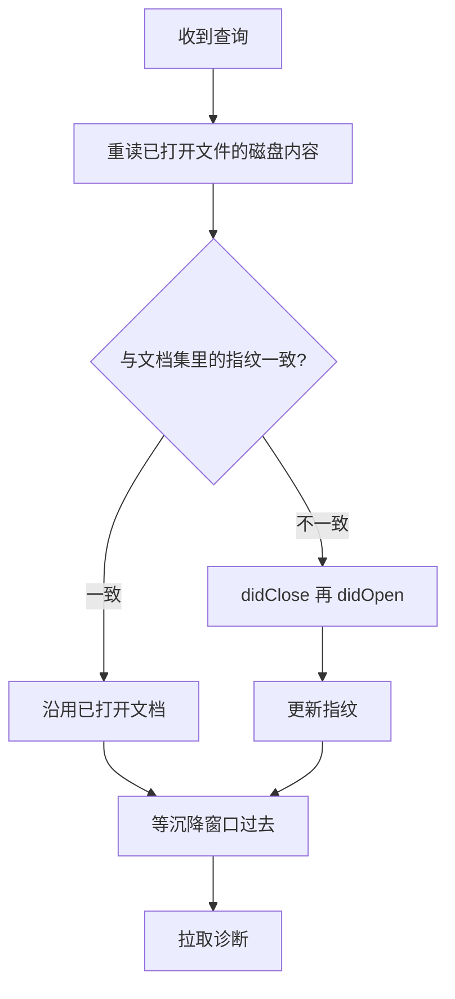

# subtask-03 文档刷新与诊断新鲜度

> **状态**: living. 事实核对时间 2026-11-11, 代码在 `5656b51f`.  
> 任务级计划见 [plan.md](plan.md); 流程见 [13-任务工作流](../../agents-cn/13-任务工作流.md).

## 目标

让常驻会话看到工作树当下的内容. 打开过的文件按磁盘内容比对, 变了就关闭重开; 诊断拉取前等到  
沉降窗口过去. 这一步只验结果对不对, 与快不快分开.

## concept primer

- 常驻会话会一直留着 `didOpen` 送进去的文档内容. 文件在磁盘上改了, server 手里的那份还是旧的,  
  诊断会照旧内容算.
- `kotlin-lsp-diagnostics.js:353-363` 的注释说的是没有 documentSymbol 那道检查才会打印假 `CLEAN`,  
  代码随后在符号为空时抛错. 现版不会打印这个假 `CLEAN`.
- 假 `CLEAN` 的真实情形是 Gradle 同步失败后模型不完整, 干净文件照样回 `CLEAN`,  
  见 `kotlin-lsp-selfcheck.js:1-10`.
- `kotlin-lsp-diagnostics.js:371` 打印 `CLEAN (0 items)`, `:410` 与 `:419` 按 ERROR 条数定退出码.
- 诊断的送达有时序. `10-分析细则:276` 记着 quickfix 的空诊断上下文来自拉取时分析还没跑完.
- 所以"快"不能拿"少刷一次文档"来换. 刷新漏一次, 结果就是假的.

## 现状与证据

| 项 | 位置 | 现在是什么样 |
|---|---|---|
| 每命令新会话 | 三个脚本的 `spawn` 与 `initialize` | 文档集随进程退出销毁, 不存在陈旧文档 |
| 假 `CLEAN` | `kotlin-lsp-selfcheck.js:1-10` | Gradle 同步失败后模型不完整, 干净文件照样回 `CLEAN` |
| 诊断时序 | `10-分析细则:276` | 拉取早了会回空表 |

## 计划改动

查询前刷新已打开文档的判定过程:

1. **daemon 侧维护文档集**  
   - 按 `plan.md:79`, 客户端每次查询前发起校验. `shared.js` 存文档集与指纹,  
     daemon 读磁盘比对, 不一致就 `didClose` 再 `didOpen`, 用新内容重新进模型.
   - 未提交的改动也算. 比对按文件内容, 不按 git 状态.
2. **诊断沉降窗口**  
   - 诊断拉取前等一段可配置的沉降窗口, 等 server 把分析跑完. 窗口长度与判据写进本子任务的实现记录.
   - 沉降窗口只管等分析跑完, 不合并查询, 也不引入新的调度行为.
3. **用 daemon 侧探针验**  
   - 探针直接调 daemon 的刷新与诊断路径, 不经过三个 CLI. 三个 CLI 到子任务 4, 5, 6 才接入.

## 有意不改

- 三个 CLI 的代码, 命令行与输出形状.
- `CLEAN` 这行输出与退出码的形状. 本子任务只保证它说的是真话.
- 不新增多文件入参, 不新增命令行开关.
- 不碰能力盘点与 quickfix 的结论, 那是子任务 7 的事.

## 覆盖核对表

| `plan.md` 的条目 | 本报告覆盖 | 留给后续 |
|---|---|---|
| 子任务 3 按磁盘比对, 变了就关闭重开 | 是 | 无 |
| 子任务 3 诊断拉取前等沉降窗口 | 是 | 无 |
| 判据改文件, 回滚, 再改, 未提交改动也算 | 是, 见验证 | 无 |
| 判据用 daemon 侧探针, 不经过三个 CLI | 是 | 无 |
| 判据汇总: 不存在假 `CLEAN` | 是 | 三个 CLI 的端到端复核归子任务 9 |
| 风险段: 刷新漏了比慢更糟 | 是 | 无 |

## 问题清单的回答

负责人没有给问题清单. 本报告按 `plan.md` 里本子任务的范围与目标自查.

## 验证

- 改文件, 回滚, 再改, 三种情况下诊断都与磁盘一致. 未提交改动也要算进去.
- 故意构造一个带编译错误的文件, 改完立刻查, 不能回 `CLEAN`.
- 探针只走 daemon 侧, 不启动三个 CLI.
- 按 `plan.md:83` 先确认连的是当前代码指纹的 daemon, 旧代码的服务进程上的结果一律不算.

## 风险

- 高, 生疏. 指纹比对漏掉编码或换行差异, 会把陈旧内容当成新内容.
- 沉降窗口定得太短仍会拉到空表, 定得太长会吃掉提速收益. 窗口要能按实测调.
- 重开文档可能触发 server 重新分析, 这一段的耗时要在子任务 9 的量测里看得到.

## 需要负责人定

- 无.
