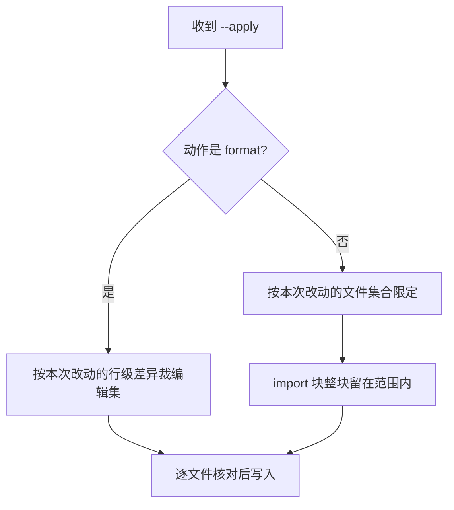

# subtask-06 edit.js 接入与编辑动作的用法设计

> **状态**: living. 事实核对时间 2026-11-11, 代码在 `5656b51f`.  
> 任务级计划见 [plan.md](plan.md); 流程见 [13-任务工作流](../../agents-cn/13-任务工作流.md).

## 目标

把编辑产出通道改成连常驻 daemon, 并给出 `format` 与 `organize-imports` 能核对的用法.  
命令行, 干跑输出形状与退出码保持不变; `--apply` 写进文件的编辑集按新设计改变,  
这正是本次要修的失效所在.

## concept primer

- 用法是 `node scripts/kotlin-lsp-edit.js format <file> [--apply]` 与  
  `organize-imports <file> [--apply]`, 见 `kotlin-lsp-edit.js:3-6` 与 `:52-62`.
  不带 `--apply` 只算编辑并打印, 带 `--apply` 才写盘.
- `organize-imports` 的编辑经 server 发来的 `workspace/applyEdit` 送到客户端, 脚本自己截获并应答,  
  不让 server 写盘, 见 `kotlin-lsp-edit.js:9-12`, `:195`, `:253`, `:458-490`.
- 两个动作现在停用. `10-分析细则:274-275` 记着实测: organize imports 把显式 import 合并成通配符,  
  format 把整份 CRLF 文件翻成 LF 并给出零宽假编辑. `10-分析细则:255` 写明停用, 脚本与干跑保留.
- `10-分析细则:249-250` 记着那条被撤回的保证: 编辑通道现在只保证越界位置钳到回车之前,  
  不再保证 CRLF 工作副本保持 CRLF.
- `10-分析细则:262-264` 的探针要领只管只读不落盘, 不打开 Gradle 模型之外的新文件,  
  以及 rename 的 180 秒预算. 它没有教怎么让新建文件进模型.

## 现状与证据

| 项 | 位置 | 现在是什么样 |
|---|---|---|
| server 与锁 | `kotlin-lsp-edit.js:133-174` | 自己 `acquireLock()`, 自己 `spawn` |
| applyEdit 截获 | `kotlin-lsp-edit.js:195`, `:253`, `:458-490` | 单客户端里截获并应答 |
| 停用 | `10-分析细则:255`, `:274-275` | 两个动作停用, 脚本与干跑保留 |
| EOL 保证撤回 | `10-分析细则:249-250` | 只保证越界位置钳到回车之前 |
| 脚本里的旧注释 | `kotlin-lsp-edit.js:33-35` | 仍写着 CRLF 工作副本保持 CRLF, 与上面撤回的保证矛盾 |
| ready 预算 | `kotlin-lsp-edit.js:102` | 读 `KOTLIN_LSP_PLAN_READY_TIMEOUT_MS` 默认 300000 |

## 计划改动

两个动作的限定范围怎么定:

1. **接入 daemon**  
   - 删掉自己的锁与 `spawn`, 改成连 daemon. `applyEdit` 只回给发起命令的那个客户端,  
     不能广播给同会话的其它客户端.
2. **写清不变与按设计改变的部分**  
   - 不变: 命令行, 干跑输出形状, 退出码. 三个 CLI 的命令行保持不变, 不新增命令行开关.
   - 按设计改变: `--apply` 写进文件的编辑集. 限定规则在脚本内部按工作树差异自动算.
3. **给两个动作各一条限定规则**  
   - 按上图裁编辑集. `format` 走行级差异那一支, `organize-imports` 走文件集合那一支.
   - import 块常在差异区外, 整块留在限定范围内, 逐文件核对.
4. **修掉两类写盘失效**  
   - 按 `10-分析细则` 的停用证据修 EOL 翻转与 import 合并, 让两个动作恢复可用.
   - 同一批把 `kotlin-lsp-edit.js:33-35` 那句旧注释改成与实际行为一致.
   - 恢复不了的形状写明原因和剩下的缺口, 不假装修好.
5. **临时副本验写盘**  
   - 用临时 `.kt` 副本, 放在仓库内已被 Gradle 模型覆盖的源码目录下.
   - 先重做 warmup 或重起 daemon 让副本进模型, 再对该副本发 `textDocument/documentSymbol`,  
     返回非空才算确认. 不在会话中途触发重导入.
   - 验完删除, 并复查 workspace 根与索引缓存.
   - 临时副本写在 `app/src/main/java/net/imknown/android/forefrontinfo/base/ZzKotlinLspApplyProbe.kt`.  
     这个目录已被 Gradle 模型覆盖, 同目录已有 `MyApplication.kt`.
   - 验完删掉该文件, 跑 `git status --short` 确认工作树没有多出文件,  
     再复查 workspace 根列表与索引缓存的键仍是单根. 路径不写进仓库代码.
6. **能力盘点不在这里改**  
   - 接入与用法结论交给子任务 7 的矩阵统一回写 `10-分析细则`.

## 有意不改

- 命令行, 干跑输出形状, 退出码.
- 不新增命令行开关, 不新增多文件入参.
- `10-分析细则` 的能力盘点. 归子任务 7.
- 仓库里的代码. `--apply` 只在临时副本上验.
- `rename` 与 `quickfix` 的接入. 判定归子任务 7, 接入实现归后续任务.

## 覆盖核对表

| `plan.md` 的条目 | 本报告覆盖 | 留给后续 |
|---|---|---|
| 子任务 6 命令行, 干跑输出, 退出码不变 | 是 | 无 |
| 子任务 6 `--apply` 编辑集按新设计改变 | 是 | 无 |
| 子任务 6 applyEdit 只回发起客户端 | 是 | 无 |
| 子任务 6 脚本内部限定, 不新增开关 | 是 | 无 |
| 子任务 6 format 行级, organize-imports 文件集合 | 是 | 无 |
| 子任务 6 修 EOL 与 import 合并, 恢复可用 | 是 | 无 |
| 子任务 6 临时副本, 进模型手段, 删除与复查 | 是 | 无 |
| 子任务 6 不单独改 10 的能力盘点 | 是 | 子任务 7 统一回写, 子任务 8 核对 |
| 判据干跑不写盘, `--apply` 逐行核对, `git diff`, 删副本, 单根 | 是, 见验证 | 无 |

## 问题清单的回答

负责人没有给问题清单. 本报告按 `plan.md` 里本子任务的范围与目标自查.

## 验证

- 干跑不写盘.
- `--apply` 在临时副本上写入后逐行核对, 仓库里的代码不受影响.
- `--apply` 之后照旧跑 `git diff` 核一眼.
- 临时副本验完删掉, workspace 仍是单根, 索引缓存没有多余模型.
- 一份 CRLF 文件上验 format 不改 EOL, 一份带显式 import 的文件上验 organize-imports 不合并成通配符.
- 按 `plan.md:83` 先校验 daemon 的代码指纹, 再跑写盘验证.

## 风险

- 高. 这是唯一有写盘动作的通道. 临时副本的位置与清理必须写进实现记录, 验完核对.
- 进模型常要重导入, 而 `10-分析细则:262-264` 警告重导入会把后续动作请求拖到超时.  
  所以进模型放在起会话之前, 不在会话中途做.
- 限定规则写错会漏掉本次改动的编辑, 或者把改动之外的代码改掉. 逐文件核对是硬判据.

## 需要负责人定

- 无.
